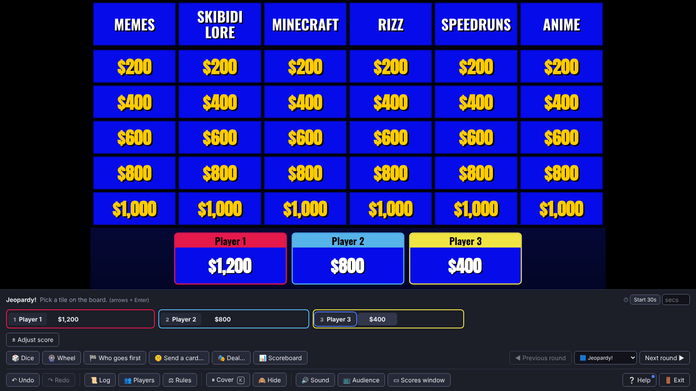
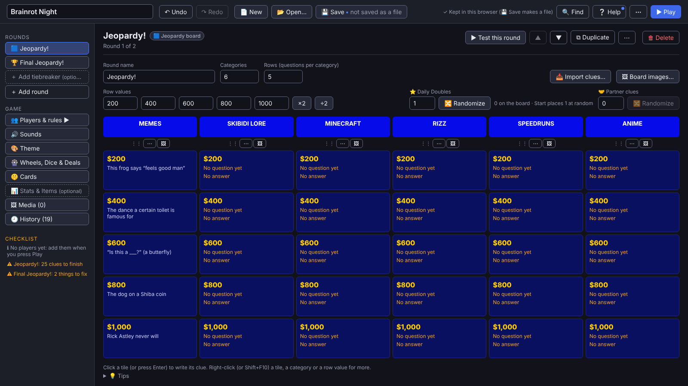
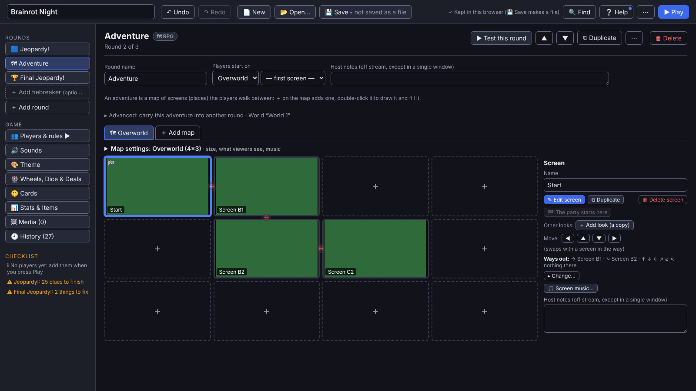
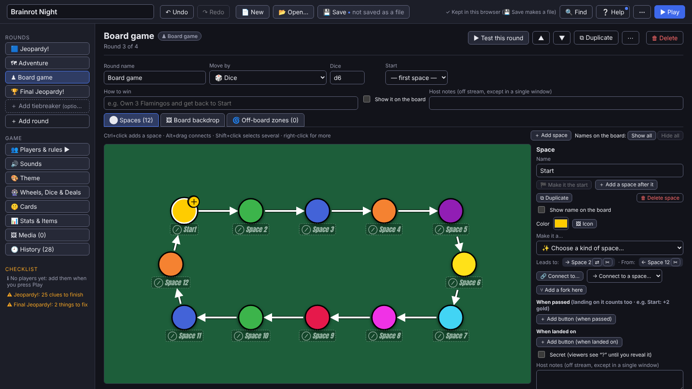
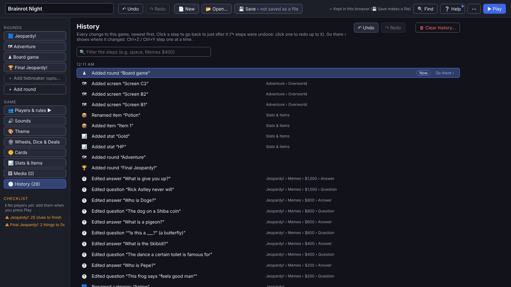
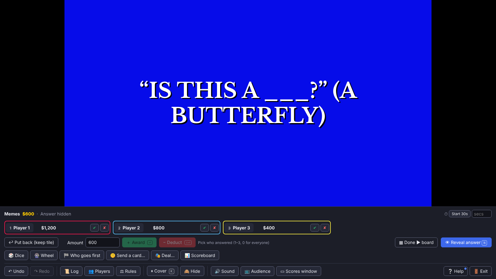
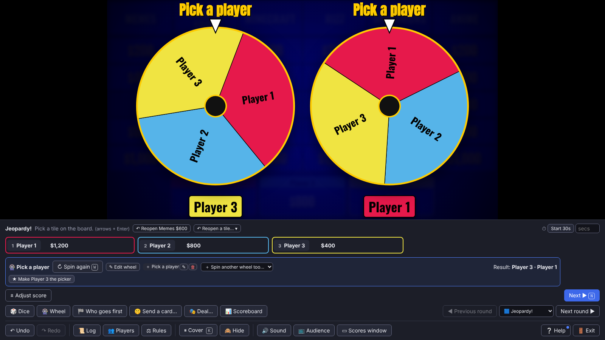
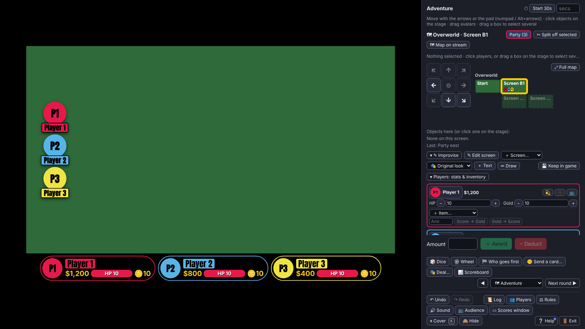
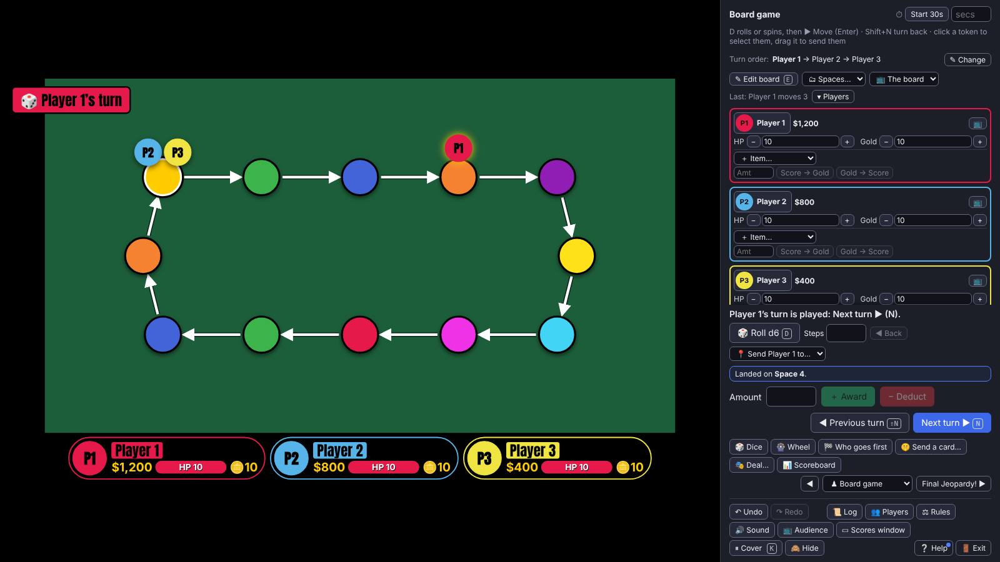

# Brainrot Games Maker

Build and host game shows for livestreams: Jeopardy boards, Final Jeopardy, RPG adventures and board games. The host
runs everything and players answer by voice on the stream, or on their phones.

The whole app is **one HTML file**. Open it in a browser with no install, server or internet. There's also a Windows
desktop app.



## Download

Get it from the **[Latest release](../../releases/latest)** (every push to `main` is released, numbered
`MAJOR.MINOR.PATCH`):

- **`brainrot-game-maker.html`**: double-click it to open it in Chrome, Edge or Firefox.
- **`brainrot-game-maker-portable.exe`**: the Windows desktop app. No install needed.

**Updating.** When a newer version is out, the editor says so (it asks GitHub each time it starts;
⚙ Settings can turn that off, and ℹ About checks any time):

- The desktop app updates itself: **⬆ Update to …** downloads the new `.exe`, checks it's signed with the project's
  key, saves your game and restarts into it, in the same place. (A copy built without the key offers the download.)
  It asks first while a ✎ / 🗜 / 🔄 job runs, and once a game has started it doesn't restart by itself: **⟳ Restart
  into …** in the editor finishes it (if it failed, the editor says why).
- The HTML file offers the new file: save it in place of the old one (same name and folder) and open it. Your games
  carry over: they're kept in the browser, not in the file. Once **⬇ Download** has opened it in a new tab, the editor's
  notice and ℹ About say these steps on the page.

The notice's **✕** at its right end is Not now: it hides the notice until a newer version is out. Every notice under the
editor's header ends the same way, with a ✕ whose tooltip says what it does.

ℹ About shows which version you have.

Old Jeopardy Builder games (`.jbr` packs and exported HTML files) still open.

## Quick start

1. **＋ Add round** and pick a mode.
2. Fill it in. For example, click a tile to type the clue, then **Tab** to the answer and **Ctrl+Enter** for the next
   clue.
3. Press **▶ Play**, then add the players (and set the game rules) on the pre-game screen.

New here? **Try a sample game** on the first screen, or start from a template: each kind of round's card there offers
a couple ("Start from: Mini quest · 3 × 3 dungeon"), and **＋ Add round** has them all, each saying what you get. Sent
a game file? The first screen's **📂 Open a game…** (or drop it on the page) opens it, and the last games you had open
are a click away beside it. **❔ Help**, at the top right, has the keys, the hosting guide and 💡 Show all tips again. **📥 Import clues…**
on a board takes a sheet pasted from Google Sheets or Excel (or a CSV or TSV file chosen or dropped on it), and **Find**
(`Ctrl+F`) searches the whole game.



## Round modes

A game is a list of rounds, and each round has a mode. You can reorder, duplicate or delete any round. **Copy round**
(a round's menu: right-click its tab, or ⋯ at the end of its page's top bar; or `Ctrl+C` on its tab) and **📋 Paste
round** (`Ctrl+V` on a tab pastes after it), or **📂 Import rounds…** (from a .brainrot file, or the web page a
game was exported as), bring a round from another game with the worlds, wheels, dice, stats, items, shops and files it
uses. Where this game already has one of those from another copy of the same game but it differs, the other version
comes in as a copy and this game's stays. A stat of a name and type this game has (HP, Gold) is this game's own, and so
is an item or shop of the same name that's the same otherwise; one of that name that differs comes in named apart
("Potion (copy)").

| Mode | What it is |
|---|---|
| 🟦 **Jeopardy board** | 1–10 categories × 1–10 clues. Supports custom values, Daily Doubles, 🤝 partner clues (placed by hand or 🔀 at random; two players, no buzzers, a steal on a miss if you like, private 🤫 cards you send to their phones or copy to them), 🤫 cards on any tile, and images on categories and tiles. |
| 🏆 **Final Jeopardy** | Private wagers, think music (with phone buzzers, players type their answer on their phone), then a one-by-one reveal and a winner screen; 🤫 cards of its own for the players you choose (＋ 🤫 Card in its editor). |
| 🗺 **RPG** | Players explore a map of screens. It has stats, items, shops, characters and doorways. |
| ♟ **Board game** | A path of spaces with forks and zones. Players move by dice, a wheel, or one space per turn. |
| 🖼 **Slides** | A few slides in a row (a welcome, the rules, a break); N goes from one to the next. |

Every clue or screen is a **slide**: text, images, GIFs, video, audio or YouTube, arranged freely.

<table>
<tr>
<td></td>
<td></td>
</tr>
<tr>
<td align="center">RPG world editor</td>
<td align="center">Board game editor</td>
</tr>
</table>

**Keyboard and drag:** round tabs, clue tiles, categories, rows, list items and map screens can be dragged and have
right-click menus; `Delete`, `F2`, `Ctrl+D` and `Ctrl+C` / `Ctrl+V` work on what's selected. `Alt`+arrows move them
too: on a board, `Alt`+`←` / `→` on a tile or a category's name moves the category and `Alt`+`↑` / `↓` on a tile its row.
A tile's menu has **Make it a…** (Standard, ⭐ Daily Double, 🤝 Partner clue, 🎡 Wheel tile…, 🎲 Dice tile…, then ✍
Everyone answers and ⬚ Empty tile), the kind it is ticked; a wheel or dice tile opens the clue at its Which wheel or
Which dice box. A tile with an answer made a 🤝 partner clue by hand (its Type, Make it a…, or a paste) starts with 🤫
Card 1 a copy of the answer, as 🔀 Randomize's do (the round's 🤫 Card choice “empty, to fill in” keeps it empty); an
empty card's words box has **⧉ Same as the answer** in its corner, and so does the checklist's line about it. A partner
clue's rules show its game, who describes and what it comes to in money on one line; the picker on the wheel, a typed
guess, a steal after a miss, the points and the part words are under **▸ More rules** (this computer remembers it open
or folded). Until a game has a tiebreaker clue, the list of rounds ends with **＋ Add tiebreaker (optional)**: one click
adds it (Ctrl+Z takes it back), and its page's ☑ Include a tiebreaker clue takes it out again. Files drop onto the slot
they belong in (a picture dropped on a tile asks: in the question, or as the tile's face). Press `?` (or **❔ Help** ›
⌨ Keyboard shortcuts) for every editor shortcut, and beside them, one click away, the host's during the game, with a filter for both. The longer help on the board, a slide, the RPG map and the board game page sits in a
**💡 Tips** fold that stays as you left it.

**Slide editor:** the selected item's buttons are in a bar pinned at the top of the side panel, its name, ⋯ (its
menu), its edit (✎ Edit text, ✎ Edit image…, ✎ Edit video… / sound…, Test link ↗…), ⧉ Duplicate, 🔒 Lock and, apart,
🗑 Delete (several selected: the same buttons, for them all), and a ⋯ just outside the selection's top-right corner on
the slide opens the same menu. Right after the slide tabs (a clue's, a Final's, the tiebreaker's, a slides round's)
is the open slide's group: ＋ Add slide, ⧉ Duplicate slide, 📋 Copy slide, 📋 Paste slide (as a new slide after this
one; its ▾ pastes over this one), ◀ ▶ and, apart, 🗑 Delete slide, the card's own on a 🤫 card's tab; a right-click on a
tab (or Shift+F10 on it) gives its menu, and Ctrl+C / Ctrl+V on a tab copy the slide and paste it as a new one.
Shape ▾ is in sections (Shapes, then Draw: ✏ Freehand line…, 🖌 Drawpad…; ⬚ Hotspot on an RPG screen only), and
**Background ▾** shows the picture as a thumbnail, with Change… and ⌫ Clear picture (the color stays) beside the Color
and ↺ Theme color, and ↺ Reset background apart. A double-click on an item (or Enter, with it selected) opens its editor: a text box's text, a
picture's ✎ Edit image, a video's or sound's ✎ Edit video / sound (or its Plays from), a link's Link box, a shape's
Fill. F2 renames an item in the Layers list (on a text box it edits the text), and after you add a picture, video,
sound or link the keys stay on the slide. ✎ Edit image, 🖌 Drawpad and ✎ Edit video / sound work alike: ↶ Undo, ↷
Redo, Reset apart, then Cancel, Apply (Insert drawing) and ✕ along the top (a video's Cancel is at its foot, by its
ways to apply), `Ctrl+Enter` applies, Esc asks before throwing changes away (Discard, or Keep editing / Keep drawing),
and ✂ Crop pressed reads ✓ Done cropping, its shapes and Remove crop beside it. In ✎ Edit image, `M` / `C` / `D` / `T` /
`S` pick ✋ Select (captions and stickers), ✂ Crop, 🖌 Draw, 🅣 Text and 😂 Sticker, a right-click on a caption or
sticker duplicates or deletes it, and its side panel says This caption / This sticker or Whole picture (Straighten,
Picture size). A right-click gives the item's menu, headed by its name, in the editors' one order (✎ Edit, 🔁 Use
another picture… (video…, sound…), ✎ Rename, ⧉ Duplicate, ✂ Cut, 📋 Copy, 📋 Paste, the restacks, Align ▸, 🔒 Lock, 👁 Hide while editing,
🗑 Delete; a Layers row has it too); on an empty spot, or beside a full-slide question's words, the slide's own (＋ Text
here, 📋 Paste here, 📋 Copy slide, 📋 Paste over this slide, 🎨 Background… where you clicked, Select all), with the
question's ✎ Edit text and Align ▸ first while it's alone on the slide. Drag a box on an empty spot to select several items. Beside a text box's words counts as empty (until
it's selected), so a full-slide question doesn't move when you meant to select; `Alt`+drag always draws a box. Items
snap to the slide and to each other while moving and resizing (`Alt` turns it off). With several selected, Left /
Center / Right / Top / Middle / Bottom line them up with each other, and **Space evenly** spreads three or more. The
**Layers** list shows whenever the slide has an item, so every item can be reached from the keyboard. Text outlines,
shadows and glows get room inside their box, so they're never cut off at its edge, and **Typewriter (letter by
letter)** types the text out (all at once with reduced motion). The same file added twice is stored once (a toast says
it's already in 🖼 Media). Replacing a file in 🖼 Media redoes the ✎ edits of pictures made from it on the new file.
**✎ Edit…** in 🖼 Media (or ✎ Edit video… on a slide's item, in its panel or its right-click menu) trims a video or
sound, and crops and resizes a video, for every place that uses it; slides' Plays from / to move with the trim. Save
as a new file keeps the original too, and from a slide item, Only this item edits it for that item alone. Ctrl+Z puts
the old file back. A picture's, video's or sound's panel has **🔁 Use another picture… / video… / sound…** (only this
item; 🖼 Media's Replace everywhere… is for every place), and a video's or sound's (or an online one's) says the part it
plays as **Plays from [0:00.0] to [the end]**: type 83, 1:23 or 1:23.5 (empty is the start or the end; ↑ / ↓ step
0.1 s), and **▶ Try it** plays that part (pressed again, it stops). That's only this item; ✎ Edit video… cuts the file
itself. Autoplay, Loop, Start muted and Volume are under **When it plays**. The toolbar's sound button is 🔊 Sound.

**RPG map editor:** drag a screen to move it or swap it with another (dropping past the edge grows the map, dropping
on a map tab moves it there), `Delete` deletes the selected screens, arrows / `Enter` / `Alt`+arrows / `Ctrl+D` /
`Ctrl+C` `Ctrl+V` / `F2` work on the grid, `Shift`-click or a box selects several (`Alt`+drag draws a box from
anywhere, on a full map too), and pictures dropped on the map become screens. Click ⛔ between two screens to block
the way. A screen's **Ways out** is one line, “Ways out: → Forest · ← ↑ ↓ nothing there”, and **▸ Change…** opens a box
for each side (the diagonals only when the map allows them, or one has a rule); it opens by itself on a screen with a
side blocked or leading somewhere else, and after ⛔. The round's world (to carry the adventure into another round) is
under **▸ Advanced**, and an item's description, notes, Use buttons and worn look under its **▸ More**; this computer
remembers which folds you left open.

**Board game editor:** the board keys the same way. It's one `Tab` stop: the arrows go to the nearest space that way
(`Shift` adds it to the selection), `Enter` opens its settings and `Tab` goes on to them. `Alt`+arrows move the selected
spaces (`Shift`+`Alt` further), `F2` renames, `Ctrl+D` duplicates, `Ctrl+C` / `Ctrl+V` copy and paste spaces with their
buttons (onto any board, in any game), `Delete` deletes. `Ctrl`+click adds a space, `Alt`+drag links two, and
**＋ Add space** on the board's tools row adds one after the selected space. A space's own buttons are right under its
name: 🏁 Make it the start, ＋ Add a space after it, ⧉ Duplicate and, apart at the end, 🗑 Delete space (several
selected: ⧉ Duplicate, 📋 Copy, Clear selection, 🗑 Delete 3 spaces). The
movement dice are kept by the dice themselves, so renaming them in 🎡 Wheels, Dice & Deals keeps them.

Other editor tabs:

- 👥 **Players & rules ▶** (first in the Game list, with how many players): the players, ⚖ Game rules and phone
  buzzers are set on the ▶ Play screen before the show, and this opens it at 👥 Players (nothing starts until **Start
  game ▶**).
- 🔊 **Sounds**: the sounds played on stream (right, wrong, dice, wheel, buzz…): preview, replace or switch each off.
- 🎨 **Theme**: presets, colors, fonts (your own font file too: Fonts › Your own font file) and background images.
  **💾 Save as new theme…** keeps a look in My themes (in this browser, or on this computer in the desktop app) for any
  game. Under **▸ Share or bring in a theme** (folded until you open it; a theme file dropped on the editor opens it),
  **⬇ Export theme** (a `.brainrot-theme` file) or **📋 Copy theme code** shares it, and **📂 Import theme…** /
  **⌨ Paste theme code…** show someone else's on your board before you use or keep it. A click on the preview finds
  the setting of what you clicked (a tile, a value, a category, a score plate, the score bar or the board): it opens
  and flashes. Tile glow's size is beside its tick, in Colors.
- 🎡 **Wheels, Dice & Deals**: weighted wheels, custom dice and 🎭 deals (a secret part for everyone). Each wheel or
  dice outcome can carry a score effect or action buttons. A new one (＋ Add, or 📋 Ready-made) opens with its name
  selected, to type over; `Enter` on one in the list (or on a 🤫 card) goes into it, at its name.
- 🤫 **Cards**: private cards made before the show (words, pictures, GIFs, videos, sounds or a link on each), each with
  a name you pick it by. During the show **🤫 Send a card…** sends one to the players you choose: only they see it, on
  their phones. In one window viewers can read a card's name in that dialog (never what's on it), so keep the secret
  on the card.
- 📊 **Stats & Items**: HP bars, currencies, items, wearable gear and shops. Until an RPG or board game round uses it
  (or it has anything in it), it's listed muted, "(optional)".

**Copy and paste** slide items or whole slides between clues, rounds and even games; their pictures and sounds come
along.

**Right-click** almost anything for a quick menu. This works on rounds, tiles, categories, list rows, map screens,
spaces, avatars and items (`Shift+F10` or the menu key opens it where the keys are, and a row's **⋯** opens it too).
Every menu goes in the same order: what a click on it does (✎ Edit), what it can do or be made (Make it a…),
✎ Rename · ⧉ Duplicate · 📋 Copy · 📋 Paste, ▲ ▼ / ◀ ▶ and ＋ Insert, its own extras, its row's or column's own group (a
tile's “Row 2 · $400”: move, insert above or below, delete), then ⌫ Clear and 🗑 Delete in red, last. Each item shows
its key, the Mac way on a Mac. A right-click in a category's name or a row value opens its menu, unless you're typing
in it: then it's the browser's Cut, Copy and Paste.

**Lists** (stats, items, shops, buttons, zones, wheel slices, a deal's parts, dice, choices) have one row: ⋮⋮ to drag
it (or `Alt`+`↑`/`↓` in it), its fields, **⋯** for its menu (⧉ Duplicate, ▲ Move up, ▼ Move down…; `Ctrl+D` duplicates)
and, apart at its end, a red 🗑 (Undo brings it back). A wheel slice's ↻ Spin again is in its ⋯ (a slice that spins again
says **↻ again** after its label; a click turns it off, and its ▸ More has the tick); `Enter` in a slice's label or a
deal part's name adds the next one, `Backspace` in an empty one deletes it. ▶ Play's players keep their ▲ ▼.

**Colors:** a click on a color box opens the app's color picker. Drag in the square and along the color bar, or type
the color as **Hex** (`#ff00e6`) or **RGB** (three numbers, 0–255): both are always there to switch between, and the
one you used last comes back (a click in the Hex box selects the color there, so one typed or pasted replaces it).
**💧 Pick from the screen** takes a color from anywhere on the screen (in the desktop app, with a magnifier to aim: click
the pixel, or press `Enter`; the arrow keys move one pixel, ten with `Shift`; `Esc`, a right-click or switching to
another window cancels). The color it was sits beside the new one, and a click on it puts it back. `Enter` or
**✓ Done** keeps the color, one undo step; `Esc` puts back the one it had.

**Undo** (`Ctrl+Z`, `Ctrl+Y` to redo) covers every change in the editor and takes you to where it happened. Deleting
doesn't ask first: a "Deleted … · Undo" note brings it back. The **🕘 History** tab lists every change and jumps back to
any point; it survives a reload (⚙ Settings sets how many changes it keeps, 300 by default). A right-click on a step
goes back to just after it (or redoes up to it), goes there, or copies its name, and a right-click on the header's
↶ Undo or ↷ Redo opens 🕘 History, as on the game screen. During the game, a right-click on a row of the 📜 Log's
🕘 History has ↶ Back to here, ↶ Reopen tile and, for a score, ↶ Undo just this score (or ↷ Restore), under the row's
own words.



## Hosting

Press **▶ Play** (or **👥 Players & rules ▶** in the editor's list) to get to the pre-game screen. Add the players there (rename, recolor, pick a picture, drag ⋮⋮ or
`Alt`+arrows to reorder; type a name and press `Enter` for the next one; `F2` in a row renames it; a right-click on a
row, or `Shift+F10`, gives its menu: 🎨 Color…, 🖼 Picture…, ± Start score…, ✎ Rename, ▲ ▼ Move and 🗑 Delete player,
from the player's 📱 Phone buzzers row too; while the buzzer room is up each row says how its phone is, where the name's
chip was: 📱 in, 📱 waiting, 📵 lost 0:12, ⛔ kicked 1:40; they're kept with the game for next time; a start score, the
points a player has before the first clue, is behind **± Start scores** by ＋ Add player, which this computer remembers
and which stays open whenever one isn't 0),
open **⚖ Game rules** for scoring, the most players, timers and the round intro, and turn on phone buzzers on the
**📱 Phone buzzers** card (all saved with the game too). `Ctrl+Z` / `Ctrl+Y` undo and redo the changes made there (the
same steps as the editor's 🕘 History, where **Go there** brings you back to this screen). Then pick one of two modes.
Viewers see a "Starting soon…" card until you press **Start game**, which stays at the foot of the window however long
the page gets (on a wide screen the page is two columns). **✅ Before you start**, in the players' column, has two
groups: **On stream** (in one window it leads with "Viewers see this page now"; then the audience window, the room and
who's in, the sound, with **🔊 Test the sound…**; ✕ folds these tips, and **Show them** brings them back) and **The
game**, the things worth fixing before you go live, each with its own **Fix ›** (to that place in the editor),
🎲 Place now or 🗜 Make smaller where they apply, and ◀ Fix in editor (to the first one); they're only warnings, and
never folded. The bar by Start game keeps one pointer to them, "⚠ 2 to check" (or "ℹ 1 note" for what Start takes care
of, such as a Daily Double not placed yet). A **🔁 Rematch** keeps the players, their colors and pictures.
A game kept to resume (Exit › Keep & leave, or a reload mid-game) shows at the top with where it got to and its scores
("⏸ Game in progress: Meme Night · Jeopardy! (round 2 of 5) · Ann $400, Bob $200 · saved 2:41 AM") and **▶ Resume it**.
Once it has points, a tile played or a roll, Start game asks first, in its bar: "Start a new game? The game in progress
(Jeopardy!, round 2 of 5) is discarded." **Not yet** (it has the keys) · **▶ Resume it instead** · **Start new game**
(red). A second `Ctrl+Enter` right after the first doesn't answer it; a later one does. With phone buzzers on and no room
as well, it's one question ("Start without phones, and discard the game in progress?", with **📱 Start the room**).

- **Single window**: viewers see this window. Press `H` (or **🙈 Hide**) to hide the host controls; **Show controls**
  waits, out of sight, in the top-right corner until the mouse moves (on a touch screen, until a tap, which does
  nothing else). With them hidden, nothing on the stage shows a focus ring until you move the keys yourself (Tab, or the
  board's arrow keys). While a box they can read is up (a partner clue's, a tile's 🤫 cards, a Daily Double's wager, a
  ✍ clue's answers), the status line says so with a **⚠ Viewers see this** chip: point at it for what they can see.
- **📺 Separate audience window**: a clean window to capture in OBS or Discord. The host window keeps the answers,
  notes and controls, and its board marks the Daily Doubles (⭐), 🤝 partner and ✍ tiles still to play. Before the
  game a line under the two cards says whether it's open: "not open yet" with **📺 Open it now** (Start opens it too),
  or "open ✓" with **Bring it forward** and **Close it** at the far end, which asks first (your stream capture goes
  black); right under it, the reminder to click the window once for sound. `A` opens it or brings it forward, and `Shift+A` opens the scores
  window, before the game as in it.

Nothing turns blue when you click, double-click or drag, nor with `Ctrl+A`, so nothing shows selected on stream: only
the boxes you type in, links, the room code (one click takes all of it), error lines, ℹ About's version and folders and
🔊 Sound help's switch and folder select. With the audience window open, the host's own column, typed answers and the 📜 Log select too, to copy into chat.
A right-click where the app has no menu of its own shows nothing, in every window (the browser's menu, with its Reload,
would be on stream): boxes you type in, links and selected words keep it. Windows only for reading (ℹ About, the keys,
🔊 Sound help, ⚖ Rules in the game) close on `Enter` as well as `Esc`, unless the keys are in a box or on a button there.
A player's menu opens with a right-click on them anywhere on the host screen: their score chip or plate, their row in
the 📱 phones list, and their button in any box (who picked a 🤝 partner clue, who found a Daily Double, who gets a 🤫
card or a 🎭 part, the Final's rows, a shop's buyer…), headed by their name only. It goes in one order: first this
moment's verbs for them (in a clue **✔ Right +$400** `Enter` / **✘ Wrong −$400** `Shift+Enter`, a 🤝 partner clue's ✔ Got
it / ✘ Missed with their share; on PARTNER UP! ★ Ann picked it / 🤝 Make Ann the partner; on a Daily Double ⭐ Ann found
it; from 🤫 Send a card… 📤 Send to Ann only / ＋ Add Ann; in the Final's wagers Plays / Sits out this Final and ✎ Set
wager…; in its reveals 🔦 Spotlight, Show answer, Show wager, ✔ Right `C`, ✘ Wrong `X`), one that doesn't fit them greyed
so the rest keeps its place; a line, then Select, ★ Make the picker and ✎ Set the score…; their round's extras and 🗂 Open
their card; while the buzzer room is up, 📱 Free seat (new phone) and ↩ Let back; and last, in red, ⛔ Kick from phone (2
min)… and 🗑 Remove player… (Remove team… with phone buzzer teams; greyed for the last one left), both asking first. `Shift+F10` or the menu key on their button, or a long press on a touch
screen, opens it too, and each item shows its key.
A right-click on the stage (or `Shift+F10` on the main button, or a long press) gives the moment's own menu. Its first
item, on its own, is the blue button's step (Show question ▶ `N`, 👁 Reveal answer `N`, ▦ Done ▶ board `N`, Next turn ▶
`N`…), and like the blue button it asks first when something's left. Then come the moment's own actions, each with its
key and never a second copy of that step (on PARTNER UP!, 🎡 Spin for a partner `W`, Make Bob the partner `2`…; in a
clue, 👁 Reveal answer `R` while the blue button is still on a slide, ⏱ Start the countdown `T`; a wheel's 🎡 Spin! `W`, ✎
Edit wheel; a Daily Double's who found it; the Final's ✔ Right `C` / ✘ Wrong `X`; a tie's ways to settle it), what its
box adds (⇄ Swap, ± Adjust score…), the way out (▦ Done ▶ board `Esc` before the answer, asking first as the clue row's
does; ↩ Put back (keep tile)), ↶ Undo and ⏸ Cover the screen `K`. It works with the controls hidden too (an item that
needs them brings them back). An item that can't be used now is greyed, not left out, so each stays in its place. In one
window it shows only what the panel shows, and ↶ Undo doesn't name its step. While the check is open, a right-click on
the stage only flashes it.
A double-click on a button that changes the screen (▶ Play, Start game ▶, Resume game, a card on the first screen, a tile
in the board editor) counts once: its second click does nothing on the new screen, and one on a score plate makes them
the picker once. On ▶ Play, a double-click on the game's title (or `F2`) renames it.

Click a tile to open its clue, then reveal the answer with `R` or a click (a double-click is one step: it never also
shows the answer, or goes back to the board and opens another tile; on a 🤝 partner clue a click never shows the answer
before the pair has had their go, judged or out of time, and during a steal says how it goes on, while `R` shows it any
time). A clue can have several question slides (a
lead-in, then more: **＋ Add slide** in the clue editor): the main button goes **Next slide ▶** (`N`, `Shift+N` back)
through them first, and the audience window shows the slide you're on. Select players and **＋ Award** (`Enter`, green,
never the blue button) or **− Deduct** (`Shift+Enter`); on the board the Amount row stays folded behind **± Adjust score** until a player is
selected (pick them with `1`–`9`, then `Enter` takes the keys to the Amount box: type the points, then `Enter`, and the
keys are back on the tile; its **✕ Close** folds it again). In a 🤝 partner clue, where ✔ Got it / ✘ Missed give the
points, it folds behind **± Other points…**, and opens by itself once you pick a player (`1`–`9`) or give points by hand
on the clue. A player's chip has a quick ✔ / ✘ (“Right: Ann +$200”, “Wrong: Ann −$200”); a ✍ clue's answer rows have
the same ✔ / ✘, the same look and words.

**A click on the stage** runs the show for a host who drives from it. Where it's the blue button's step (the round's
intro, the next slide, the answer, back to the board), it asks first when something's left, as the blue button does;
where it's what the stage shows, it does it (a wheel spins, dice roll, a board game's landed dice move the token, a
pop-up shows its answer). On PARTNER UP! (its "?" too) it's Show question ▶, asking first for who picked it and the
partner. On a Daily Double's splash it's its Show question ▶ for the wager typed; with who found it or the wager missing
the status line says so, and the keys stay in the Wager box. On the Final's wagers it never shows the question: it says
who it waits on (“Waiting on Bob's phone & Cat…”), or “All wagers in: Show question ▶ (N)”, and the box says “✓ All 3
wagers in”. On the spotlit player's card it's Show answer ▶, Show wager ▶, then Next player ▶ (never a verdict: with
one due it asks for it). While a 🤝 partner clue's cards are handed out it starts the clock when there's nothing to send
to phones (the status line says “Clock started” with **↶ Undo** for a few seconds), asks first while cards wait for a
phone, and with a card to copy by hand not 📋 copied yet says “Copy the card to Bob first (📋 in the 🤝 box), then click
again to start the clock”. A slides round's last slide and finishing the Final take a second click (“Last slide: click
again (or Next round ▶) to go on”); `N` and the blue button go at once. What a click says shows in the status line at
the top of the panel; with the controls hidden, the moment's menu opens where you clicked, under it.

The host panel keeps one layout in every round: the status line (with the 📱 phones and ⏱ timer chips on the right),
the players' score chips, the row of what this moment needs, and at its right the one main button with its key
(**👁 Reveal answer** and **▦ Done ▶ board**, both `N`, **Show question ▶** `N`, **Next ▶** `N` over a tool, **Next
turn ▶** `N`, the Final's next step `N`…). When it's blue it's only ever the show's next step (Next slide ▶, 👁 Reveal
answer, ▦ Done ▶ board, the round's intro, Next round ▶): what gives points, opens the buzzers or rolls is in its own
row. In a clue the row beside the blue button (Amount, ＋ Award, − Deduct) is its flow row, and its buttons keep their
places as the clue goes on: **↩ Put back (keep tile)** (`Shift+Esc`) at its far left, the row's width from ▦ Done (on a
Daily Double's splash it leads the Wager row; on PARTNER UP! it has the row to itself), and at its right end ◀ Slide
(with more than one question slide), 👁 Reveal answer while the blue button is still a slide, and ▦ Done ▶ board, a
quiet skip that closes the clue without its answer (asking first, as the blue button would); once the answer is up,
🙈 Hide answer takes ▦ Done's place. A place that's not in use stays empty, and the blue button keeps one width through
the clue, so nothing moves under the pointer; on a crowded row their words go (their signs stay, still named in full)
rather than the row wrapping; and the row stays in
view at the panel's foot as the rows above it scroll (in a 🤝 partner clue in one window the box's own foot holds that
place). The tiebreaker's row is the same, with 🏁 Back to results. On a played-out board, Next round ▶ is the blue
button and its place in the round navigation stays empty, so ◀ Previous round keeps its. Under the row come the tools
(🎲 Dice, 🎡 Wheel, 🏁 Who goes first, 🤫 Send a card…, 🎭 Deal…, 📊 Scoreboard, pressed while it's on screen) with
the round navigation (◀ Previous round, as ◀ up to 1440 px wide, the round list, Next round ▶) at the right,
then a fixed bar that never moves, in groups by what they're for: **↶ Undo ↷ Redo · 📜 Log 👥 Players ⚖ Rules · ⏸
Cover 🙈 Hide · 🔊 Sound 📺 Audience ▭ Scores window · ❔ Help 🚪 Exit** (on a narrow window, as their signs only: ▭
Scores window as ▭ up to 1340 px wide; beside the stage in RPG and board-game rounds ↶ Undo and ↷ Redo keep their
words, and 🔊 Sound, 📺 Audience and ▭ Scores window have a line of their own). ▭ Scores window shows ● while it's
open, as 📺 Audience does. On a short window (a laptop zoomed in) the round's
own box (✍ answers, the Final's wagers, an RPG round…) keeps a few rows in sight, and the panel scrolls. A moment's own
box holds its actions, each in one place: in a 🤝 partner clue, **🎡 Spin for a partner** (`W`) comes first in the box,
in front of the players to choose from by hand (**↻ Spin again** in its place after; with “Partner from the same team”
ticked, only the describer row's), the cards' details fold into one quiet line (“🤫 2 cards · 📋 you'll copy them”: a
click opens it, and it opens by itself when a player a card goes to has no phone here, or its files won't reach the
phones), and the box's foot, always in view, has ✔ Got it / ✘ Missed and, while the cards are handed out, at its right
end a 📋 for each card you copy by hand and **📤 Send and start** or **⏱ Start the clock** (`Enter`). The action due now
wears a ring. The blue button there is the show's next step only: **Show question ▶** on PARTNER UP! (`N` or `Enter`;
**Next ▶** while the partner wheel is up, which puts it away and shows the pair, as `Esc` does: the wheel's own box has
no ✕ Close then), then 👁 Reveal answer and ▦ Done ▶ board; PARTNER UP!'s ↩ Put back (keep tile) shows its key, `Shift+Esc` (`Esc` there does it too). A click on a box's
button leaves `Enter` and `W` where they were. A wheel's or
dice's box keeps its buttons in their places: **🎡 Spin!** `W` (or **🎲 Roll!** `D`) first, then **↻ Spin again** (or
**↻ Roll again**) in its place once it's spun, greyed while it turns (ringed when it lands on a "Spin again" slice), then
✎ Edit wheel and ＋ Spin another wheel too…, the result, and “Who was it for? (optional, kept in 📜 Log)”; it has no Close: putting it away is the blue button's. On a wheel or dice tile that's **Show
question ▶** (**▦ Done ▶ board** on a tile with no question), greyed while it turns, and 🎡 Spin! wears a ring until it's
spun; over anything else (a wheel or dice from the tools row, 📊 Scoreboard, a player's sheet, a roll-off) it's **Next ▶**,
which only puts it away (the moment's own step is the next press). A question pop-up's blue button is **👁 Reveal
answer**, then **Next ▶**; its box keeps **✕ Close** until the answer is up, to put it away unseen. `Esc` closes any of
them at once (with a score effect not given, it says so first: `Esc` again closes without it). Pressed with something left, the blue button (or a click on the stage) asks first in the check below: a
wheel or dice tile not spun or rolled yet (**First:** 🎡 Spin! `W`, `Enter`; a tile with no question can close without it,
staying on the board), landed on "Spin again" (↻ Spin again), a score effect not given (**✔ Give Ann +$100 ▶
question**, or **Choose in the box** for a steal, a swap or nobody chosen), or a question pop-up's player picked with no
points (＋ Award Ann $200 and close it). A tool from the tools row never asks about spinning. While a box is open (a
🤝 partner clue's, a Daily Double's wager, a tile's own wheel or dice, the Final's), the tools row steps back, drawn
without its fill, so the box is what you see first; every tool still works. A Daily Double's box opens at its top, the keys in its Wager box, its Wager row ending with True Daily Double; **Show question ▶** is the blue
button (never greyed), and `Enter` in the Wager box is that too: with who found it or the wager missing (or over the
max) the keys stay in the box, the names or the box flash, and the status line says what to do ("Type a wager (Ann can
wager up to $1,000), or True Daily Double"). In a 🤝 partner clue with its clock running, ✔ Got it and ✘ Missed are an equal pair
in its box (neither blue), and the blue 👁 Reveal answer asks first while they play. In the Final the blue button is its
next step: **Show question ▶** (`N`, or `Enter` in its last wager box; never greyed: with a wager missing, not a whole
number or over the max, the keys go to the first box to fill, its row flashes, and the status line says whose: “Waiting
on Bob's phone & Cat: type their wagers, or Sits out”; the wager box's first line says the same, by name only, or “✓ All 3
wagers in: Show question ▶ (N)”), **👁 Reveal answer** (as on a clue), **Start player reveals ▶**, then one by one
**Show answer ▶** / **Show wager ▶** / **Next player ▶**, and **Finish game ▶** (by `N` twice once everyone is judged,
as before). The verdicts are only in the rows, **✔ Right** `C` then **✘ Wrong** `X`, the one a multiple-choice pick
points to ringed; the spotlit row's Show answer or Show wager is empty while the blue button does it (the other rows keep
theirs, to show a player out of turn). The reveal rows are in straight columns: the player, their typed answer (cut short
with …), Show answer, the score and wager, Show wager, then ✔ Right and ✘ Wrong at the right end, in the same place on
every row. Finishing early is the quiet **Finish now…** at the left of the box's foot, beside “2 still to judge”, away
from the verdicts (it asks first); it hides while the blue button is Finish game ▶ itself. A tie for first on the results screen is settled in its box, which holds every way:
**❓ Tiebreaker clue**, **🎲 Tiebreaker roll-off** `O`, **🤝 Declare co-winners**; that screen has no blue button (`N`
says to settle the tie there, and the box flashes, as the status line does). Under it, after the show, all on the left in
one place, tie or not: ◀ Back to final reveals, 📋 Copy standings, **▶ Next game…**, then **🔁 Rematch** last and set
apart (it asks first); once there's a winner the status line says so, “🏆 Bob wins · the show is over: 📋 Copy standings
for chat, or 🚪 Exit”. The tiebreaker clue's blue button is its slides, 👁 Reveal answer,
then **🏁 Back to results**; its box asks **Who won? 🏆 Ann 🏆 Bob**, the tied players only: one click settles the tie with no
points (their number then `Enter` does the same, and another 🏆 changes it), and the Amount row folds behind
**± Also give points…**. The status line says “Who won the tiebreaker? Click their 🏆, or press their number then
Enter”, then “🏆 Bob won · 🏁 Back to results (N)”. In a board game the blue button is **Next turn ▶** (`N`), ◀ Previous turn (`Shift+N`)
quiet beside it; the roll and the move are the turn box's, in one slot under a first line saying what to do (“Ann's
turn: 🎲 Roll (D), then ▶ Move (Enter, or click the dice once they land)”): **🎲 Roll** (`D`), then **▶ Move Ann: 3**
(`Enter`) in the same place once the dice land (greyed while they roll, ringed while it's what's next), the Steps box and
◀ Back beside it. A click on the landed dice (or movement wheel) moves the token too, with `Enter`'s checks; `Esc` only
puts them away. While ✎ Edit board is open there's no blue button: **✓ Done editing** (`Esc`) is in the edit panel.
While a partner clue's cards are handed out, `T` (or the status line's ⏱
Start) starts the clock: with no card waiting for a phone the clue goes live, as **⏱ Start the clock (45 s)** does, and the
first `Enter` after it only says so; with phone cards still to send it's the clock only, and **📤 Send the cards (clock
running)** (`Enter`) sends them.
**The check before going on.** The blue button pressed (a click, `N`, or a click on the stage) while something is still
left doesn't go on: a small card opens inside the panel, over its right part (never the stage, the status line or the
fixed bar, and never a button where the blue button is), saying what's left: **First:** the buzzers never opened (🔔
Open the buzzers `U`), a buzzer tie (🎲 Roll for it `O`, or who answers), ✍ answers still coming in (⏱ Start the
countdown `T`), a tile's 🤫 card not sent yet (📤 Send it); **Before you go on**: a player picked with no points yet
(**＋ Award Ann $200 ▶ board** `Enter` / **− Deduct** `Shift+Enter`), ✍ answers not judged (✔ Judge all ▶ board, ✍
Judge them, ✘ The rest are wrong). In a 🤝 partner clue: on PARTNER UP!, who picked it (their number), the partner (🎡
Spin for a partner `W`, or a player's number: it closes, so the pair shows first), who describes, or with nobody to
partner with Solo or ↩ Put back `Shift+Esc`, each to be done first (no "anyway"); at 👁 Reveal answer, the cards not
handed out or the clock not started (📤 Send and start `Enter`, ⏱ Start the clock, 📋 Copy Card 1's words), the pair
still playing (✔ Got it ▶ reveal `Enter` / ✘ Missed `Shift+Enter`) or a steal open (who steals it); at ▦ Done ▶ board,
not judged (✔ Got it ▶ board / ✘ Missed ▶ board). In the Final: its own 🤫 card not sent at Show question ▶ (📤 Send it),
typed answers still coming at 👁 Reveal answer (⏱ 10 more seconds `Shift+T`), and at Next player ▶ or Finish game ▶ the
spotlit player not judged yet (**✔ Right** `C` / **✘ Wrong** `X`, to be done first: each closes the check, so the verdict,
the wager and the new score land on stream, then `N` goes on). In a board game, Next turn ▶ asks while the turn isn't
played, and one check walks it: **First:** 🎲 Roll (`D` or `Enter`), “Rolling…”, then ▶ Move Ann: 3 (`Enter`) or, at a
fork, the ways (click them: the numbers still pick players), “Moving…”, then the landing's actions not run yet:
**▶ Run Lucky's actions ▶ next turn** when they're all done at once (points, a stat, an item, a sound, a skip, a roll
again), **▶ Start Lucky** when a roll, spin or question decides the rest, or **▶ Run Lucky's actions** when one puts
something up or asks who (it closes the check while that plays out). Each line ticks as it's done (“✓ Ann rolled 4”),
ending on **✓ Ann's turn is played** with Next turn ▶ (`N` or `Enter`). **Before you go on:** a question worth points
that came up this turn with nobody given any (＋ Award Ann $200 ▶ next turn). However the landing's actions run (its
row's buttons, its space's card, ▶ Run all, the stage's menu), it counts, and an Undo of them asks again. Nothing asks
for a turn that ends without a move: in a zone or off the board, a wheel slice naming no number, nowhere to go. `D` and
`Enter` never ask, so `D`, `Enter`, `N` is still three presses with nothing left. At the tiebreaker's 🏁 Back to results with nobody its
winner yet, **Before you go on**: **🏆 Ann won ▶ results** for each tied player (the one picked with their number takes
`Enter`), or 🏁 Back to results, still tied. Card names and who they're for, never their words. A quiet **▦ Done anyway: no points** (or **👁 Reveal anyway**, `R`) and **Not yet**
(`Esc`) are at its foot; `N` again is "anyway" (not at a reveal, where `N` only says to press `R`). For its first 0.6 s
it takes no key or click (a double press never goes on by mistake: what it would have pressed lights up), an `Esc`
right after Not yet does nothing, and the keys go back to what opened it. `Shift+click` on the blue button goes on
without asking; `Esc` still closes a clue at once. What's left gets a ring on its own button in the panel too, and
"Don't ask about … again this game" turns a kind off. With the controls hidden in one window, what can wait goes on
(points not given at ▦ Done) and a reveal with something left changes nothing on stream: the **Show controls** pill
pulses and `H` shows the panel with the check open; in two windows the controls come back while it's open and hide
again after.
Anything that asks first (Exit, closing the audience window, leaving a round, 🔁 Rematch) asks in one strip right
above that bar: Cancel on the left, the answer on the right. Leaving a round always asks, unless a board is played out
(then **Next round ▶** is the main button), and says what leaving does, its answers too: “7 clues are left in
Jeopardy!. Go to Double Jeopardy!?” **Keep playing** / **Go to Double Jeopardy! ▶**, or “End the game now? 7 clues are
left.” **Keep playing** / **End game ▶**. It stays while you read it (the pointer on it or the keys in it). In RPG and board-game rounds on a wide window the panel is a column beside
the stage, with the same parts and 🚪 Exit in the bottom-right corner.
The rules can change mid-game too: **⚖ Rules** next to 👥 Players in the host panel opens ⚖ Game rules (they count at once
and are kept with the game), and at the most players 👥 Players offers **Raise Most players**.
Every change can be undone with `Ctrl+Z`, including RPG and board game moves, items and live edits.
Nothing pops up over the stage: questions for the host (a locked door, naming a new screen…) appear in the host panel.
Screen readers hear what's going on: the game starting or resuming, the host panel's status line, who is selected and
who picks next, awards and scores (the Final's reveals too), how the game ended (the winner, a tie to settle,
co-winners), dice, wheel and roll-off results, the countdown and the
scoreboard going on or off, RPG moves (doorways and regroups too) and board-game turns, the buzz order (as it ends up)
and who is answering, a phone's wager coming in (never how much), and the app's notes are announced (politely, a burst of
changes said once, with a window open too). The host's board is one Tab
stop: the arrow keys go from tile to tile. The Stage and the Host controls are named regions, to jump between. In
Windows High Contrast, the selected players and pressed buttons are outlined, while the stage viewers see (and the
editor's previews and theme cards) keeps the game's own colors. On a touch screen, the buttons a row shows when pointed
at (📜 Log's ↶ Back to here, 🕘 History's Go there ›, the ⛔ between screens on an RPG world's map) show anyway.



**Tools, any time:**

- 🎲 Dice
- 🎡 Wheels, including a built-in **Pick a player** wheel (**Pick a team** with phone buzzer Teams). Several wheels can spin at once.
- 🏁 Who goes first
- 📊 Scoreboard (with 📋 Copy standings for chat)

**Phone buzzers** (Buzzer mode, on the pre-game screen's 📱 Phone buzzers card, saved with the game): tick **Phone
buzzers on** (with **Teams** beside it), press **▶ Start the room** right under it and share the code, link or QR code
(it's on the viewers' Starting soon card too). The card goes in the order you use it: who's asking to join first, then
each player's phone (**📱 Free seat (new phone)** first, **⛔ Kick** apart at the end, in red), then the options folded
under **▸ Buzzer options**, whose line says how they're set ("Buzzers open with the clue · new players: no · colors on
phones · 1 s early wait"; it opens by itself only when this buzzer server can't do one of them, and this computer
remembers whether you left it open), and at the foot **🔒 Lock seats** and, apart, **⏹ Close the room…**, which asks
first while any phone is in. While phone buzzers are off, the card says what the game uses phones for ("This game uses
phones for 🤝 partner cards (3 clues) and ✍ multiple choice. Without phone buzzers you copy the cards to the players
yourself, and they say the letter."). Players open the link on their
phone, tap their name and get a big BUZZ button, Jackbox-style; new players can ask to join from their phone if you
allow it (until the game has its most players). Before the game, the bar by **Start game ▶** says who's in and who it's
waiting for ("📱 Room CPQL · 1 of 3 joined · waiting for Bob, Cat", green once everyone is), and who's asking to join,
with the card's **✔ Add** and **✕ No** right there (two or more: **Show ↓** takes you to them on the card). With **Teams** on, each player is a team: people pick their team on their phone and type their own name, and
whoever on it buzzes first answers for the team ("Ann (Red team)" in the buzz order); a wrong answer locks out the
whole team. A room holds up to 24 phones at once: once 24 people are on teams, the next phone is told the game is full
until someone leaves. On a Daily Double or a Final, players type their wager on their phone and send it: it fills in your
wager box (marked 📱, and you can still change it), they can change it until you show the question, and only you see
how much (in one window, where viewers see your panel, a Daily Double's stays hidden there until **Show wager**). In a Final they then type their answer on their phone too (or tap one of its multiple choices), and you
reveal each one on stream. On a ✍ Everyone answers clue nobody buzzes: everyone types an answer on their phone, or
taps one of its multiple choices (shown on stream under the question too), and only you see what they sent (once you
judge one, that player can't change it). The buzzers open when the clue does, or when you press `U` (or **🔔 Open the
buzzers** in the buzzers' row) after reading it.
The fastest reaction wins, timed on each player's own phone, so a slow connection doesn't cost anyone the buzz. Every
buzz is listed in the host panel, fastest first: a wrong answer locks that player out (struck out where they are in the
list) and the next one who buzzed answers at once, in bold (**⏭ Skip** passes them on with no points taken); once nobody
who buzzed is left, the buzzers open for the rest, and **↺ Reset buzzers** (`0`) lets everyone buzz again. Buzzes
within 0.01 s are a tie: **🎲 Roll for it** (`O`, in the buzzers' row) sets who answers first (the roll leaves the stage once you judge, skip or
take the next in line), or pick one yourself (`1`–`9` or a click always picks by hand). Viewers
see "🔔 Ann is answering" whenever one player is picked during a clue. Phones also say who got a clue right (a Daily
Double too) and what's on (a Daily Double's player sees "you're up"; on a 🤝 partner clue every phone's button greys
and says who describes and who guesses), beep and flash when BUZZ! lights up (🔔 mutes), and **Not you?** lets a
player change seats. A long question fits the phone: its text gets smaller (down to a size that's still easy to read)
and past that it scrolls, with ▼ More.
🤫 Cards go to a player's phone through the buzzer server, only when you send them (📤 in the
partner clue's panel): their words, links, pictures and videos, your own files included (pictures are shrunk first;
a big GIF, video or sound can go as a smaller copy for phones: **🗜 Make smaller…** on its card in 🖼 Media, or
**🗜 Make smaller** on the host panel's line about it during the game, see Card files under
[Set up your own buzzer server](#set-up-your-own-buzzer-server)).
The phone shows a card in place of the buzz button, behind **Tap to see** (🙈 Hide covers it again), and the panel says
✓ seen once it's opened. YouTube, Drive and Streamable videos play in their own player when tapped. The buzzer server
keeps a card until the tile closes (or the round ends, or you take it back, for one sent with 🤫 Send a card…), and
the card's pictures and videos up to 10 minutes longer. A phone that takes
the seat or joins the team after a card went out doesn't get it: the panel says so, and ↻ Send again gives it to it.
After **Exit › Keep & leave** the cards out stay on the phones until you resume the game (or discard it).
With teams, **☐ Partner from the same team** (or the wheel landing on the picker's own team) spins a wheel of that
team's people: the card goes to the one who describes, the rest of the team is told who's describing, and the team
scores once. On an older buzzer server, or for a player without a phone, you copy the card to them (📋).
With **A miss on a partner clue lets the others steal it** (⚖ Game rules, or each clue's own **After a miss**), ✘ Missed
opens the buzzers for everyone else, the two who missed it locked out (without phones you pick who steals, `1`–`9`):
a right steal gets the tile's value, a wrong one loses it, as on any clue, and Ctrl+Z on the miss closes the steal.
**🤫 Send a card…** in the tools row sends a card to any players, teams or people on a team, at any time and in any
round: one of your 🤫 Cards, a tile's or a Final's card made in the editor, or a quick one (words typed or pasted, with
a picture, video or sound, or a link). It lasts until the round ends or until you take it back; **🤫 2 cards out** next
to it lists them by the name the app gives each ("Card 2 → Ann", never what's on it) with ↻ Send again and ↩ Take back;
it turns orange when one isn't all on the phones (a picture that didn't go up, a phone that came late), and that card's
row says what. A card made in the editor that you change after it went (▶ Resume with my edits) comes off the phones
until you ↻ Send it again, keeping its place among the cards the phones hold meanwhile.
Any tile can have 🤫 cards (＋ 🤫 Card in the clue editor): a standard or Daily Double tile's are offered in its panel to
the player who picked it (a private question, a tip before the wager), go only when you send them, and go away when the
tile closes; the tile plays as it always does. A Final can have 🤫 cards too (＋ 🤫 Card in its editor): its panel offers
them from the wager screen to the last reveal, each starting with everyone playing it (the chips change who gets it;
teams go whole), they go when you press 📤 Send, and they go away when the Final ends (during the wagers, and during
the question while players type their answers, a card sits above the wager or answer box on the phone, so one or two
per player keep that box in sight). Give a tile's or a Final's card a name (**Card name** on the card's bar; F2 on
its tab) to tell them apart: its tab, the host panel and 🤫 Send a card…
show it instead of "Card 2". Phones never get it, but in one window viewers can read it in the host panel, so call a
card what it's for, never what's on it. An RPG object, an item, a wheel slice, a die face or a board space can
have a **🤫 Send a card** button (who gets it: whoever set it off, the party, a player you pick then, or everyone else):
pressing it in play only offers the card in the panel, under what offered it (a board game's landing box, a space's
or an object's card, the wheel's or dice's box; at the panel's top once that's gone), and it goes when you press
📤 Send there (Skip sends nothing).
For a player with no phone, **🪟 Card window** (in 🤫 Send a card…) opens a window with only that player's cards,
pictures and videos included, to share with them alone (a Discord DM call) or show them on a second screen. With no
phones getting cards, 🤫 Send a card… and an action's offer put a card there with **🪟 Show**. Viewers never get it:
share only the game window.
**🎭 Deal…** next to it hands everyone a secret part, each on their own phone: 🕵 Odd one out (one spy, everyone else
gets the same location from a wheel), 🐺 Secret roles (a wolf, a seer, villagers), 🧢 Team captain (one on each team)
or 🧠 Everyone's own prompt (a slice of a wheel each), or a deal of your own made in the editor's 🎡 Wheels, Dice & Deals tab (parts with a
card each and how many get it; a part's **Edit card…** shows its card with 📱 On their phone beside it, as its players
get it, with a sample slice when it draws from the wheel). 🎭 Deal shuffles the parts (with the audience window open you can choose who gets one,
and the column beside the stage shows who got which); nothing goes until you press 📤 Send, which sends each player's
card on its own, their part ("You're the Spy") on it behind Tap to see. In one window the panel only counts the parts
("Spy ×1, Villager ×4") and lists everyone dealt in alike, a part or not (with the phones getting the cards, those with
no phone here, 📵, to copy theirs). Once it's dealt, its button in the tools row says how it stands, “🎭 Spy night ·
sent” (or not sent, cards back, and “· on screen” while Who was who is up), orange when a phone missed its card. Inside,
its buttons go by purpose: **On phones** ↻ Send again and ↩ Take the cards back, for the whole deal; **On stream**
**🎭 Show who was who**, which puts everyone's part on screen when you choose (🙈 Hide who was who, a click on it, Esc or
Ctrl+Z takes it off, and so does opening a tile or the tiebreaker, going to another round, or the Final going on); and,
set apart, **This deal**: 🎭 Deal a new one and 🗑 End this deal (its cards back, the parts forgotten; it asks first
while they're out).
A player on a computer opens the same link: `Space` (or `Enter`) buzzes, `1`–`9` pick their seat or team, `Esc` goes back, and the page says when another window (the stream, say) has the keyboard. The room stays open
through the pre-game screen, a reload of it or of the game (▶ Resume it on the pre-game screen, or Resume game, goes back into it unless a phone joined a room started there: one nobody joined closes on ▶ Resume it or ◀ Back to editor), **◀ Back to editor**, **Exit › Keep & leave** (Resume goes back into it)
and **▶ Next game…** (▶ Play asks to keep it for another game, which then has its players, and Teams on if it was); it closes with **Exit › Discard & leave**, when you leave the results screen any other way than
▶ Next game…, with **⏹ Close the room…**, or when Buzzer mode is turned off (not by undoing, in the editor, the step ▶ Play
made to turn it on for the room). Its phones are told the game is over, or, on a phone that never saw the game
start, that the host closed the room (ask for the new code if the game goes on). The join code shows small in a corner of the stream
during the game (at the end of the score bar on the board) and on the cover card; the On stream options can hide it.
**🔒 Lock seats** keeps new phones out (a player with no phone then reads "🔒 locked out"), and a player whose seat you take back (⛔ Kick) can't take it again for 2 minutes, unless you press **↩ Let back** on their row meanwhile.
The rooms run on a small buzzer server
(`buzzer/`, a Cloudflare Worker); the release builds come with one, and ⚙ Settings › Buzzer server can point at your
own ([Set up your own buzzer server](#set-up-your-own-buzzer-server): free, about 10 minutes). Copies built without one say "Phone buzzers aren't set up in this copy", and play a game saved with Buzzer mode
on without it (you pick who answers); the setting stays with the game for a copy that has a server.

**Sounds** are built in and on by default (right, wrong, dice, wheel, buzz, reveal, and an RPG's quiet steps,
doorways, pick-ups, coins and damage…): preview, replace or switch each
off in the editor's 🔊 Sounds tab (↺ goes back to the built-in sound; a sound switched off keeps the file chosen for it).
The players and rules aren't there: the tab says so at the top, with a button to the ▶ Play screen.

**For OBS:** Theme › Stage background can be chroma green or magenta for keying (the pre-game screen warns when a
player's color is close to the key, which would key it out, and the Theme page and the pre-game screen name the theme's
colors OBS would make see-through, such as Brainrot Neon's green values on the green key, and the pre-game screen also a
board game's backdrop, spaces and zones or RPG screens it would, such as a new board's green backdrop; the Daily Double
splash and 🤝 PARTNER UP! take colors the key leaves alone), and **▭** (or `Shift+A`) opens a
scores-only window for a lower-third capture. Capture these windows with OBS's **Window Capture**: a Browser source
runs in OBS's own browser, which can't reach the host page. The "Starting soon" and cover cards can be edited, with a
countdown (the host sees its time left). They're under the pre-game screen's **📺 On stream** fold, whose line says
what's set ("📺 On stream · “Starting soon” card · cover card · captions on"; this computer remembers whether you left it
open, and it opens by itself while the countdown runs), with **Reduce motion on stream** too.

**Made to read on a scaled-down stream** (720p or 480p in Discord): scores shrink to fit their plates and long names
end in "…" instead of being cut off, a board's values share one size that fits its columns, category names never get
smaller than about 30 stage pixels (very long words are hyphenated; the editor's checklist says when a name is too long
for the board), the countdown and "🔔 Ann is answering" move the question down instead of covering its first line,
and score pops stay on screen. New players get colors that stay apart for color-blind viewers (the first 8); a game
keeps the colors it was saved with. The winner's confetti is a short burst beside the standings (none with Reduce
motion on stream).

**Single-window mode shows viewers everything on screen**, including wagers as you type them, answers, host notes and
hidden objects. Use the separate audience window when that matters.



**RPG rounds** have these controls, in the host panel's RPG box from the top: the parties, 🛒 Shop… and 🗺 Map on
stream; the selection line; the movement pad and the minimap at every height, with the box of a tool on the stage (a
shop, a wheel or dice, a question) and the card of an object beside them; **▸ ✎ Improvise**; then the players. The RPG
box has no blue button of its own (an object's card and the full map's buttons are plain).

- The stats strip along the bottom never covers the screen: the screen is scaled into the room above it (past 6
  players the strip is one row of compact cards). The map on stream is solid, and the players' dots on it carry their
  initials.
- A movement pad, and a minimap that expands to the full map so you can jump the party anywhere. On a big world the
  minimap shows the screens around the party; the arrow keys go from screen to screen on it.
- The map on stream (`V`) shows only what viewers know, with a cell around it, and says when the party is on a map
  hidden from them.
- Split and regroup parties. An object's "the party" buttons act on the party standing at that object.
- Player cards with stats and inventory.
- An object's card (a click on it on the stage, or in Objects here) and its menu (a right-click there, or `Shift+F10`)
  hold the same buttons, in the same words and order: ✋ Ann picks up 🪙5, 🚪 Go through, 💬 Talk, 🛒 Shop, its
  actions (🎲 Roll d6, HP −1, +$500…) and ▶ Run all; the menu then has 🗂 Open its card, ✎ Edit, 🙈 Hide from viewers and
  🗑 Remove (`Delete`). A button that asks something first (who it's for, with nobody there; a locked door) opens its
  card. In one window a secret object's buttons wait on its card, behind 👁 Show, and its steps say “a hidden object”
  even when they were taken with the audience window open.
- Shops. A right-click on a ware in the shop on the stage: **🛒 Buy for** each player, or **📦 Change the stock…**
  (asked in the shop's box).
- Live improvising, under **✎ Improvise** (open until you fold it; this computer remembers): ✎ Edit screen, ＋ Screen…,
  another look for the screen, ＋ Text, ✏ Draw objects on a drawpad, 💾 Keep in game. Dropping a picture on the stage
  and the stage menu's ＋ Text here… work with it folded too.
- Select several players and objects and drag them together: the group keeps its shape, and one drag is one undo
  step. **Drag a box** on an empty part of the stage: the players, and the things they can pick up or use (items,
  money, characters, things to use), inside it are selected. A box replaces what's selected; `Shift`, `Ctrl` or `⌘`
  adds to it (so does a box on a touch screen), and so does `Shift`+click on one avatar or object. Doors, zones, shops,
  hazards, scenery and 🔒 locked things stay out of a box (a press on a locked one, or on a picture as big as its
  screen, draws a box too): `Shift`+click adds one of them. `Alt`+drag always draws a box, even from a player or an
  object; on some Linux desktops `Alt`+drag moves the window, so the stage's menu has **▭ Select in a box** (and
  **Select everything here**). `Esc` while drawing puts back what was selected. A click on an empty spot clears the
  selection, as `Esc` and its Clear selection do, and **↩ Select them again** brings it back for 5 seconds. One line at the top of
  the RPG box says what's selected (in one window a secret object is "1 hidden object", and Objects here numbers the
  secret ones, never naming them). In one window the stage shows the box and dashed outlines while you hold the
  button, and for a moment after; pressing one of a selected group outlines the whole group before it moves. To
  another screen only the players go: the toast says what stays ("Ann & Bob → Meadow · Sword stays on Start").
- The stage is a `Tab` stop: `Shift+F10` there opens the selected player's menu (their first, with several), else the
  selected object's, else the round's own (🗺 Full map, the map for viewers, 🤝 Regroup).

**Board game rounds** have these controls (as in RPG rounds, the board is scaled into the room above the stats
strip, so no space is ever under it; the turn banner does go over the board's top edge, and the editor's checklist
notes a space up there):

- The host panel's board-game box starts with the turn: the turn box (its first line, the one slot, the Steps box, ◀
  Back and **📍 Send … to…**), the round's own dice (or movement wheel) under it once rolled, a fork's ways, then the
  **landing box**, framed: the spaces passed and landed on, their buttons and 👁 Reveal space. Beside the stage (a wide
  window) that part sits at the column's foot, by the blue button, in sight as the rest scrolls. Under it: a space's
  card, then the turn order in one line, “Turn order: Ann → **Bob** → Cat ✎ Change” (✎ Change opens its chips: drag one,
  or `Alt+←/→` on a name, to move them in the order, click a name for their turn, 🔀 Shuffle; this computer remembers
  it open), then ✎ Edit board, 🗂 Spaces…, 📺 The board and 🛒 Shop…, with the last step and ▸ Players at its end.
- Roll (or spin the movement wheel) and move, picking the way at each fork: in the turn box, **🎲 Roll** (`D`) becomes
  **▶ Move** (`Enter`, or a click on the landed dice) in the same place, then **Next turn ▶** (`N`) is the blue button;
  it asks first while the turn isn't played (see the check above). A wheel's slice or a die's own face moves
  as far as the number it names ("3", "Move 3"; "Back 2", "Go back 2" or "◀ 2" move back). Moving back goes back the
  way the player came.
- Send players to any space (📍 Send … to… in the turn box: the selected players, else whoever's turn it is; in one
  window a secret space not revealed yet is “? (secret)” there and in 🗂 Spaces…).
- Each space's actions, for the player they're for (the one who landed there, or the ones picked on its card).
- The board from the keyboard: it's one `Tab` stop (the space the keys were last on, else where the turn player
  stands), the arrows go to the nearest space that way, `Enter` (or `Space`) opens its card and `Shift+F10` its menu
  (📍 Put them here, ▶ Run its landing actions…). Only once the keys took them there: a click on the board lets the
  space go, so `D`, a click, then `Enter` still moves the token. `Shift+F10` on a name in the turn order (✎ Change
  opens it) opens their menu (🎲 Make it their turn…).
- **✎ Edit board** (`E`) while you play: add, move, connect, rename and delete spaces (players on a deleted space go to
  the one before it); **✓ Done editing**, `E` or `Esc` goes back to playing. In a single window a secret space not revealed yet is
  “? (secret)” there too (its Name box shows its name only after 👁 Show, and its ⚙ Buttons… its buttons and notes only
  after 👁 Show its buttons).

<table>
<tr>
<td></td>
<td></td>
</tr>
</table>

**Ties** for first aren't called a win on stream until they're settled, in one of three ways:

- A roll-off, whose winner wins the game (🎲 Tiebreaker roll-off in the tie box, or `O` on the results screen).
- A tiebreaker clue (❓ Tiebreaker clue in the tie box): its box asks **Who won?**, a 🏆 for each tied player, and one
  click settles the tie with no points (their number then `Enter` does the same, and so does 🏆 their name when 🏁 Back
  to results asks); **± Also give points…** opens its Amount row for points too.
- Co-winners (🤝 Declare co-winners in the tie box).

The winner fanfare plays once the tie is settled. Each way settles only the tie it was used for: a score fixed later
into a tie with someone else opens it again.

**Exit** keeps the game in progress, and **Resume game** picks it up later, even after a crash. Resume asks how the
game is shown, **Single window** or **📺 Separate audience window** (the same choice as before the game), and a game
left with the screen covered comes back covered.

### Keyboard shortcuts

The main ones (press `?`, or **❔ Help** at the end of the host panel's bar, before or during the game for all of them,
starting with the ones for the round or screen you're on; the window has a filter, and its **[ Editor | During the game ]**
switch shows the editor's keys too). After an update, the window starts with **🆕 What moved in this version**: where
buttons went and their new names, for a host who knows the old places (open the first time, folded after; ❔ Help has a
dot until you've seen it). The filter finds a renamed button by its old name too:

| Key | Action |
|---|---|
| `1`–`9` | Select player N |
| `P` then `1`–`9` | Make player N the current picker |
| `Enter` / `Shift+Enter` | Award / deduct (on a ✍ multiple-choice clue with its answers locked and nobody selected, `Enter` is ✔ Judge all) |
| `R` | Reveal / hide the answer (the countdown stops; on a wheel or dice tile, `R` while its wheel or dice is up says to spin, roll or close it first, and `R` again shows it anyway) |
| `←` `↑` `→` `↓` on a tile | Move across the board (`Enter` opens the tile; after a clue the keys go on from its tile) |
| `Esc` / `Shift+Esc` | Back to the board at once / ↩ Put back (keep tile): the tile stays playable |
| `N` / `Shift+N` | The blue button: Next or Reveal (intro, a clue's next slide, 👁 Reveal answer, ▦ Done ▶ board, a Daily Double's Show question ▶, a tool's Show question ▶ or Next ▶, the Final's steps, Next turn ▶). With something left it asks first, and `N` again goes on anyway, except into an answer (`R` does that) / one step back, never asking |
| `Shift`+click on the blue button | Its step at once, without asking (what must be done first still asks: who picked a partner clue, the partner, the spotlit Final player's verdict) |
| `C` / `X` | Final reveal: right / wrong |
| `T` / `Shift+T` | Start/pause the timer / 10 more seconds |
| `D` / `W` / `O` / `S` | Roll the last dice again (a board game's own dice) / wheel / roll-off (on a tie for first: the tied players; in a buzzer tie, 🎲 Roll for it, which never asks) / scoreboard |
| `K` or `B` | "Be right back" cover (every round): the countdown and the clue's video wait under it |
| `0` | Select everyone or no one (in buzzer mode, during a clue: reset the buzzers) |
| `U` | Buzzer mode: open the buzzers (when they open on your key) |
| `A` / `Shift+A` | Open (or focus) the audience window / the scores-only window |
| `L` | Log: the history (go back to any point), scores and rolls |
| `H` | Hide / show the host controls |
| `F` | Full-screen |
| `Space` / `←` `→` / `M` | Play/pause, seek, mute media |
| `Y` | Open YouTube / online media in its own window |
| `Ctrl+Z` / `Ctrl+Shift+Z` | Undo / redo |
| `J` / `V` / `G` (RPG) | Full map / map on screen / regroup everyone here |
| `I` (RPG, board game) | Player sheet |
| Arrows, numpad or `Alt`+arrows (RPG) | Move the party |
| `E` (board game) | ✎ Edit board while you play |
| Right-click, `Shift+F10` or the menu key | The menu of what you point at, or what has the keys: a player (anywhere), a tile, a board-game space, or the moment's own on the stage and the main button |
| `?` | Every key, with a filter (❔ Help does the same), and what the check doesn't ask about this game, each with **Ask again** |

**In the check** (the card the blue button opens when something's left): `Enter` does the fix that shows ⏎ (never
"… anyway" nor Not yet; with nothing left, the step, or, with players selected where `Enter` awards, ＋ Award as outside:
`2` then `Enter` gives Bob the points, never the answer), `Shift+Enter` the one that shows ⇧⏎, `N` is "… anyway" except
into an answer (`R` there), `Esc` is Not yet (a second `Esc` right after does nothing), and `W` `D` `U` `O` `C` `X` `T`
the fix that shows that key. `1`–`9`, `K`, `B`, `M`, `Space`, `←` `→` and `F` work as outside, the check staying open
(a number a fix shows, a tie's "Ann answers `1`" or a steal's, presses that fix); `?`, `L`, `A`, `H` and `Ctrl+Z` close
it as Not yet first. For its first 0.6 s it takes no key or click (`Esc` aside),
so a double press never skips it. Its "Don't ask about … again this game" turns one kind off for the game (landings,
rolling, opening the buzzers, a tile's wheel or dice, typed answers still coming); the keys window lists what's turned
off, each with **Ask again**.

A key held down counts once (only the arrows repeat). With the keys on the main button in a slides round, or on a
round's title card, `Enter` does what the button says, as `N` does; on a 🤝 partner clue's PARTNER UP! it's Show
question ▶ wherever the keys are, and once the question is up it's 📤 Send and start (or ⏱ Start the clock), then ✔ Got
it. `W` spins for a partner; `N` never spins, sends or judges. `Enter` in a Daily Double's Wager box is Show question
▶; an `Enter` right after its question goes up doesn't judge its player yet: press it again. On a wheel or dice tile not
spun yet, `Enter` says to spin first (`W`, or `D` for dice).

## Saving

- **Save** (`Ctrl+S`) writes a `.brainrot` pack: the game plus all its media. It reads **💾 Save •** while the game has
  changes no file has yet (“not saved as a file” beside it where the header has room), and its tooltip says when it was
  last saved as a file. The editor keeps your game as you go anyway: in a browser the header says **✓ Kept in this
  browser** (💾 Save makes a file), in the desktop app **✓ Autosaved** (with the time of its last autosave file).
  - In the desktop app, saves go in a **BrainrotSaves** folder next to the `.exe` (in Documents\BrainrotSaves when the
    app may not write there, e.g. in Program Files). Closing the window while a save is being written asks whether to
    wait for it. While autosave can't write (a full disk), closing the window asks first too, as a browser tab does.
  - In a browser, they're downloads. A file over 100 MB asks where to save it instead (Chrome, Edge), so a big download
    can't fail unnoticed.
  - Changes made while a save is being written aren't in it, so they still count as unsaved.
- **Open…** (`Ctrl+O`) is one window: your **Recent games** and, in the desktop app, **Your saves (BrainrotSaves)**
  newest first with their date and size (📂 Saves folder shows the folder), then **Browse for a game file…** at its foot.
  `↑` / `↓` go from game to game and `Enter` opens one; `Delete` takes a recent game off the list (it asks first), and a
  right-click or `Shift+F10` gives a game's menu (▶ Open, 📁 Show in folder, 🗑 Delete from Recent games…). Browse also
  opens `.json` games, exported HTML files and the desktop app's `.bak` backups. Dropping a game file (`.brainrot`, `.zip`, `.json`, `.html`) on the
  editor opens it (a `.brainrot-theme` file opens on the 🎨 Theme page), and the desktop app opens a game, a `.bak` or
  a theme file you open it with ("Open with", or dropped on the `.exe`). One given during a game opens when you're
  back in the editor.
  - **Recent games** keeps the last 8 games New or Open… replaced (about 1 GB of files at most), with their undo
    history. When one has to go to make room, the app says which. Two versions of one game are both kept. A game with
    only a title isn't kept. **🗑 Delete** asks first: it deletes the kept copy and its files.
  - Opening an older copy of a game never changes the pictures and sounds of the game you have open: a file that
    differs is opened as a file of its own.
- New and Open… ask **Cancel / Open anyway / Save first** (or **Start new anyway**) when the game has unsaved changes
  (Open… checks the file is a game first); going on anyway keeps the old game in Open… → Recent games. The sample game
  as it came asks nothing (it's kept in Recent games too, and ↶ Reopen previous game brings it back); once changed, it asks. Only one browser tab edits at a time: another tab waits, paused, and offers **Edit here** once the
  editing tab closes.
- **⋯ → Save a copy as: ⬇ Export as a web page… (play-only)** (Export HTML) makes a **play-only web page**: a single file
  to play the game from, without this app, with everything inside. It shows the answers, so keep it to yourself. (**{ }
  Export JSON**, under it, is the game as text only, without its pictures, for editing by hand.) Every file in 🖼 Media goes in, used or not: a big file's size question says how much of it is
  files nothing in the game uses (**🗑 Delete unused** leaves them out). A game over about 375 MB is too big for one
  HTML file (browsers can't read it back): save a `.brainrot` instead.
- Add pictures, videos, sounds and fonts on the **🖼 Media** page: drop them there, or use **＋ Add files…**. A video or
  sound this browser can't play is offered a fix as soon as it's added (🔄 Convert: repackaged in seconds with nothing
  lost when only its file type is the problem, as with an MKV, or an .mts whose sound plays here; a camcorder's .mts
  usually loses its Dolby Digital sound), and Ctrl+Z puts the old file back. Each file's card has its buttons in the
  same places: its name with ⋯ (its menu) and 🗑 at the right end, then at its foot ✎ Edit… (a video or sound),
  **Replace everywhere…** (every place it's used follows, on stream too) and the one fix that applies (🔄 Convert…, ↻
  Make it a…, 🗜 Make smaller…). **used 3× ▾** lists where it's used (slides, the theme, 🔊 Sounds, tile and category
  pictures, wheels, RPG and board-game things), and a click on one goes there and flashes it. A right-click on a card
  (or Shift+F10, or a long press) gives its menu: ✎ Edit…, Replace everywhere…, the fix, ✎ Rename (F2), 🔍 Show where
  it's used ▸, 🌐 Check it still loads (a link's), 🗑 Delete file; with several selected, 🗜 Phone copies for N… and 🗑
  Delete N files.
- **⚙ Settings** (in the header's ⋯ menu, with Export as a web page, Export JSON, ⌨ Keyboard shortcuts, 📖 How to host
  (this guide) and ℹ About) has these options:
  - **Reduce motion on stream** (the editor, the host controls and your own copy of the stage beside the audience
    window also follow your computer's reduce-motion setting).
  - **Undo**: how many changes Ctrl+Z and the 🕘 History tab remember (300 by default).
  - **Autosave** every few minutes (desktop app). The default is every 5 minutes, keeping the last 3.
  - **Save replaces the game's last save** and keeps the two before it as `.bak` / `.bak2` (desktop app, on by
    default); off makes `Game (2)`, `Game (3)`… instead. Autosaves are kept per game.
  - **Buzzer server**: where phone buzzer rooms are made, with a **Test** button (the release builds come with one).
    An exported HTML file keeps the server it was exported with. Its **How to set up your own** link opens
    [Set up your own buzzer server](#set-up-your-own-buzzer-server).
  - **Back to the defaults…**, at the window's foot, asks first ("Put every setting here back? The buzzer server goes
    back to the built-in one."), with Cancel first and **Put them back**: it can't be undone.

## Set up your own buzzer server

Phone buzzers need a small server where the host and the phones meet. The release downloads come with one, so most
people never need this. Set up your own if your copy says **"Phone buzzers aren't set up in this copy"**, if you built
the app yourself, or if you'd rather not depend on someone else's. It runs on **Cloudflare Workers, free**: no credit
card, and it stays well within the free plan's limits for game nights.

You need about 10 minutes, a computer with a terminal (Windows: PowerShell), and:

- a free **[Cloudflare account](https://dash.cloudflare.com/sign-up)**;
- **[Node.js](https://nodejs.org/)** 20 or newer (the LTS download is fine);
- this project's files: **Code → Download ZIP** on the GitHub page (then unzip it), or `git clone` it.

**1. Install the server's tools.** Open a terminal in the project's folder, then:

```sh
cd buzzer
npm ci
```

**2. Log in to Cloudflare.** This opens your browser; click **Allow**.

```sh
npx wrangler login
```

**3. Publish the server.**

```sh
npx wrangler deploy
```

The first time, Cloudflare may ask you to pick a `workers.dev` subdomain (any name you like, once per account). When
it's done it prints the server's address, like:

```
https://brainrot-buzzer.your-name.workers.dev
```

**4. Point the app at it.** In the app, open **⋯ → ⚙ Settings**, paste that address into **Buzzer server**, and press
**Test**: it should say **✔ The buzzer server is answering**. That's it: on the ▶ Play screen, the **📱 Phone
buzzers** card can now open a room. (The address is kept on this computer; one typed without its `https://`, as
Cloudflare's dashboard shows it, gets it. A game exported as a web page keeps the server it was exported with.)

**Updating it.** When a new version of the app comes out, get the new files and run `npx wrangler deploy` in `buzzer`
again (step 1's `npm ci` too if it's a fresh download), ideally not in the middle of a game: phones reconnect by
themselves, but a buzz in flight could be lost. Older and newer copies of the app keep working with it.

**Or let GitHub do it.** If you keep your own copy (a fork) of this repository on GitHub, every push to `main` can
publish the server for you: add two repository secrets under **Settings → Secrets and variables → Actions**:

- `CLOUDFLARE_ACCOUNT_ID`: in the Cloudflare dashboard, **Workers & Pages** (on the right-hand side).
- `CLOUDFLARE_API_TOKEN`: **My Profile → API Tokens → Create Token**, with the **Edit Cloudflare Workers** template.

To build the address into your own releases too (so nobody has to paste it), add a repository **variable**
`BUZZER_URL` with the server's address.

**If something's wrong:**

- **Test says "No answer from there"**: check the address (it starts with `https://` and ends in `.workers.dev`),
  and that the deploy finished without errors. A new `workers.dev` address can take a minute or two to start answering.
- **`npx wrangler login` doesn't open a browser** (on a remote machine, say): run `npx wrangler login --browser=false`
  and open the link it prints.
- **The deploy asks about Durable Objects or a plan**: the free plan is enough; this server uses the kind of Durable
  Objects the free plan includes.
- If the free plan's daily limits are ever reached, new buzzes stop until the next day's reset. It never charges you.
- **Card files** (the pictures and videos hosts send to phones on 🤫 cards) are 90 MB each at most and 900 MB a room by
  default, just under what Cloudflare's free plan allows, and count against a budget for the whole server, 4,000 MB in
  any 24 hours by default; past it, hosts copy those to their players (📋) until it frees up again. Change them with
  `FILE_MB`, `ROOM_FILES_MB` and `FILES_MB_PER_DAY` in `buzzer/wrangler.jsonc` (`FILES_MB_PER_DAY` `0` turns card files
  off), then deploy again: the app asks the server, so it follows on its own, and ⚙ Settings › Buzzer server › Test says
  what it takes. A file over 16 MB that the server takes still goes, with a note in the editor and the host panel that
  phones on mobile data may wait a while for it. A big GIF, video or sound can go as a smaller copy instead: **🗜 Make
  smaller…** on its card in 🖼 Media (or 🗜 in the 📱 preview or the checklist) makes one, which phones get while the
  show keeps the file as it is (Ctrl+Z takes it back): a GIF as a small looping video that phones show like the GIF, a
  video at 720p, 480p or 360p, a sound made again, and a video or sound can hold only the part its cards play. 🖼
  Media's **🗜 2 files are big for phones** makes copies of all of them at once. A .mov or MKV that plays here but phones
  can't open is repackaged for them with **↻** instead (in its place, for the show too, nothing lost; Ctrl+Z undoes it),
  and a video or sound phones can't play that can't be repackaged (a FLAC, say) can get a copy they can (🗜). During the
  game too: the host panel's line about a card's big files, the pre-game ✅ Before you start card's and the host column's have
  **🗜 Make smaller**, for the game being played (the editor's game keeps the copy as well; a card already out switches
  over to it). In one window its window names no file and shows no preview, and mid-game it opens in the host panel,
  never over the stage. A copy that still comes out too big for the server (an encoder can go over on a busy picture)
  says so, and 🗜 again offers only copies smaller than it (a smaller picture, or only the part the cards play), their
  sizes as far over; where none can be (a GIF's, or a sound's its cards play all of), it says to add the file from a
  link. It works the computer hard for a minute or two, so the stream may stutter: it's best done in the editor before
  the show. It needs the app opened from a file or an https:// address, in Chrome, Edge, Firefox or the desktop app;
  where the browser makes H.264 and AAC (Chrome and Edge on Windows or Mac, the desktop app) it makes MP4 and M4A files
  every phone plays, elsewhere WebM and OGG (Opus), which some iPhones may not play.
  See [buzzer/README.md](buzzer/README.md#card-files). Each room keeps
  its cards only until the tile closes (or the round ends, or the host takes it back, for one sent with 🤫 Send a card…),
  and their files up to 10 minutes longer (20 hours after their upload began at most: the app puts one up again if a
  card still needs it).

More about how the server works (fair timing, limits, local testing) is in [`buzzer/README.md`](buzzer/README.md).

## Streaming the sound (Discord, OBS)

In dual-window mode, the sound plays from the **audience window**. **🔊 Sound** in the host panel (and **🔊 Test the
sound…** before the game, in ✅ Before you start) has a **Test sound** button, a speaker picker (e.g. for a virtual cable
into OBS), and step-by-step help.

**Discord:**

1. **Share Your Screen › Applications**.
2. Pick the audience window, with **Sound** on.
3. If viewers hear nothing, turn on Discord's *experimental method to capture audio* (**Voice & Video › Screen Share**)
   and restart Discord.

**Desktop app:**

- Don't run it as administrator or with compatibility settings. Discord and OBS can't hear it then.
- The **Discord audio fix** is on by default. Switch it off in the 🔊 Sound help.
- If the window stays blank, turn the fix off in either of these ways, then reopen the app:
  - Start the app with `--no-audio-fix`.
  - Create an empty file named `discord-audio-fix-off` in `%APPDATA%\com.brainrotgames.maker\`.

  ```bat
  mkdir "%APPDATA%\com.brainrotgames.maker" 2>nul & type nul > "%APPDATA%\com.brainrotgames.maker\discord-audio-fix-off"
  ```

The desktop app keeps its data in `%LOCALAPPDATA%\com.brainrotgames.maker`: the game you're editing, Recent games, a
game in progress and media. Settings go in `%APPDATA%\com.brainrotgames.maker`. Your saves, exports and autosaves are in
**BrainrotSaves** next to the `.exe`. **ℹ About** shows and opens all three (the editor's first screen says so, with **ℹ
See where**). To uninstall, delete the `.exe` and the two
`com.brainrotgames.maker` folders; keep BrainrotSaves (or move it) if you want your saved games.

## Third-party code

Two libraries are bundled into the app as they are:

- [mediabunny](https://github.com/Vanilagy/mediabunny) 1.61.6, © 2026-present Vanilagy and contributors, under the
  Mozilla Public License 2.0 (its source is at github.com/Vanilagy/mediabunny): 🗜 (smaller copies of 🤫 cards' files
  for phones), 🔄 Convert, ✎ Edit and the check whether a video or sound plays here use it. It reads videos and sounds,
  and writes the copies, converted and edited files (repackaged as they are, or made again with the browser's own
  video and sound encoders, WebCodecs).
- [omggif](https://github.com/deanm/omggif) 1.0.10, © 2013 Dean McNamee, under the MIT license: 🗜 uses it to read a
  GIF's frames. Its license:

  > Permission is hereby granted, free of charge, to any person obtaining a copy of this software and associated
  > documentation files (the "Software"), to deal in the Software without restriction, including without limitation
  > the rights to use, copy, modify, merge, publish, distribute, sublicense, and/or sell copies of the Software, and to
  > permit persons to whom the Software is furnished to do so, subject to the following conditions:
  >
  > The above copyright notice and this permission notice shall be included in all copies or substantial portions of
  > the Software.
  >
  > THE SOFTWARE IS PROVIDED "AS IS", WITHOUT WARRANTY OF ANY KIND, EXPRESS OR IMPLIED, INCLUDING BUT NOT LIMITED TO
  > THE WARRANTIES OF MERCHANTABILITY, FITNESS FOR A PARTICULAR PURPOSE AND NONINFRINGEMENT. IN NO EVENT SHALL THE
  > AUTHORS OR COPYRIGHT HOLDERS BE LIABLE FOR ANY CLAIM, DAMAGES OR OTHER LIABILITY, WHETHER IN AN ACTION OF CONTRACT,
  > TORT OR OTHERWISE, ARISING FROM, OUT OF OR IN CONNECTION WITH THE SOFTWARE OR THE USE OR OTHER DEALINGS IN THE
  > SOFTWARE.

ℹ About says so too, with omggif's license.

## Development

```sh
npm install
npm run dev            # dev server
npm run build          # → dist/index.html (one self-contained file)
npm run check          # type-check
npm test               # unit tests
(cd buzzer && npm ci)  # once: the buzzer server's packages (its e2e tests run it)
npm run test:quick     # the quick end-to-end test (about a minute; CI waits for it before releasing)
npm run test:e2e       # the full end-to-end suite (about 25 minutes in CI; CI runs it alongside the release)
npm run test:buzzer    # only the phone-buzzer end-to-end files (they start a local buzzer server)
npm run screenshots    # regenerate docs/screenshots (build first)
npm run desktop:build  # Windows app (needs Rust + Tauri prerequisites)
```

The stack is Svelte 5, TypeScript and Vite, bundled into a single file. The desktop app is [Tauri](https://tauri.app)
(`src-tauri/`). Specs are in [`docs/SPEC.md`](docs/SPEC.md) and
[`docs/GAMES-MAKER-SPEC.md`](docs/GAMES-MAKER-SPEC.md).

| Path | What's there |
|---|---|
| `src/lib/` | Model, game flow and scoring, tools, media, saving, RPG (`rpg.ts`) and board game (`boardgame.ts`) logic |
| `src/editor/` | The editor |
| `src/play/` | Hosting: the stage, host panel, RPG and board game play |
| `src/audience/` | The audience window |
| `src-tauri/` | The desktop app |
| `tests/e2e/`, `scripts/` | Browser tests, the screenshot script and the version script |

### Versions and releases

Versions follow [Semantic Versioning](https://semver.org). Every push to `main` is released by CI as `vX.Y.Z`
(`.github/workflows/build.yml`), numbered by `scripts/version.mjs` from the last release and the `CHANGELOG.md`
lines the push adds:

- only lines under **Fixed** → a patch (1.4.2 → 1.4.3);
- anything under **Added**, **Changed** or **Removed** → a minor (1.4.2 → 1.5.0);
- a line marked **Breaking** (e.g. saves older versions can't open) → a major (1.4.2 → 2.0.0).

`package.json`'s version is a floor: raise it by hand (`node scripts/version.mjs set 2.0.0`) for a deliberate step.
`node scripts/version.mjs check` makes sure `package.json`, `package-lock.json`, `src-tauri/tauri.conf.json`,
`Cargo.toml` and `Cargo.lock` agree. The release notes are the changelog lines added since the last release.

**Signing the desktop app's updates** (once): the desktop app only installs an update signed with the project's key.

1. `npx @tauri-apps/cli signer generate -w ~/.tauri/brainrot-update.key` (works from any folder; pick a password;
   keep the key file private and backed up: without it, installed copies can't update themselves any more).
2. In the repository's Settings › Secrets and variables › Actions: secret **`UPDATE_SIGNING_KEY`** = the key file's
   contents, secret **`UPDATE_SIGNING_KEY_PASSWORD`** = its password, variable **`UPDATE_PUBKEY`** = the public key
   it printed (also in `brainrot-update.key.pub`).

Without them CI still releases, unsigned, and the desktop app offers the download instead of updating itself.
