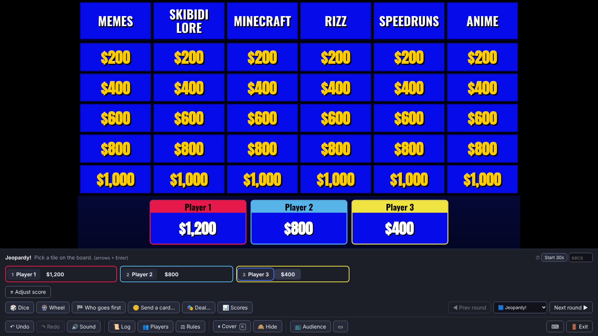
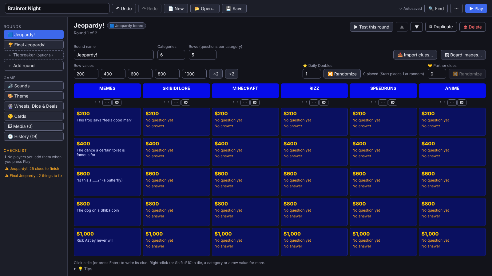
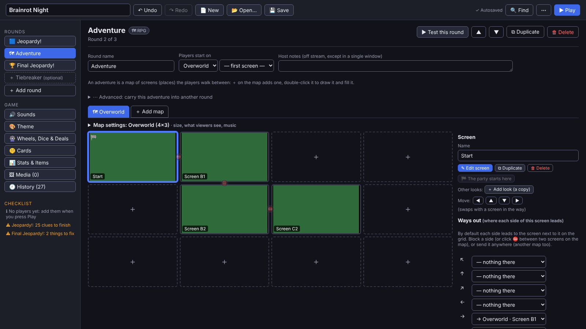
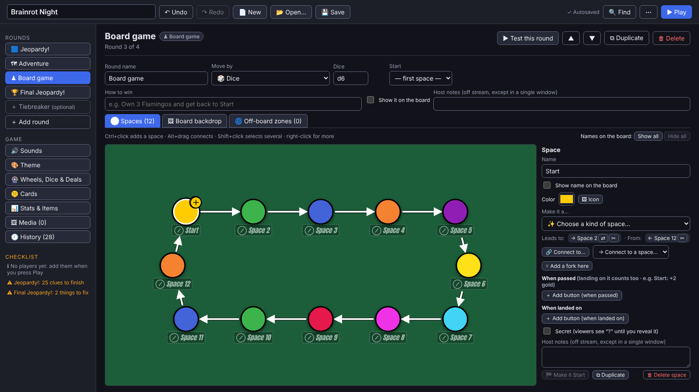
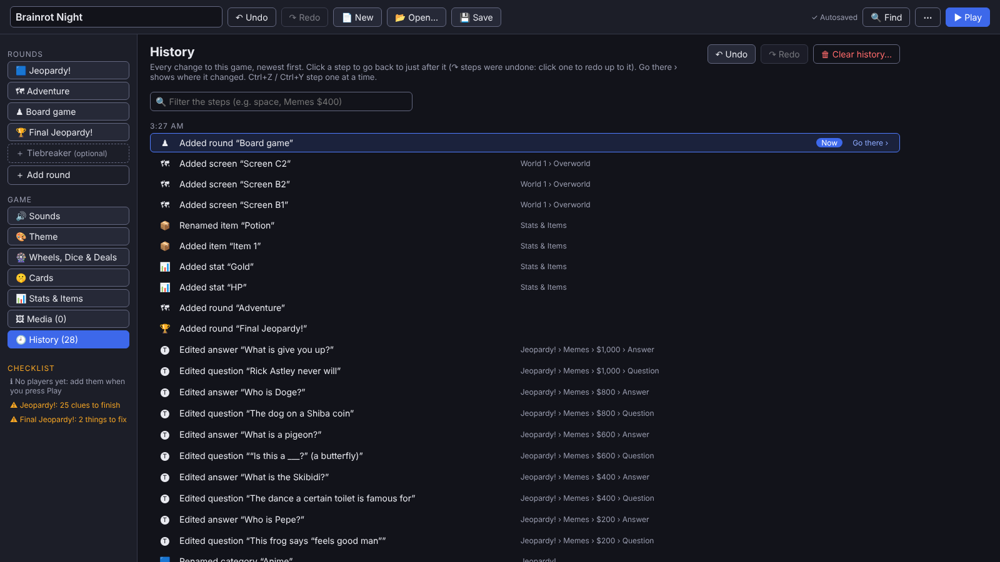
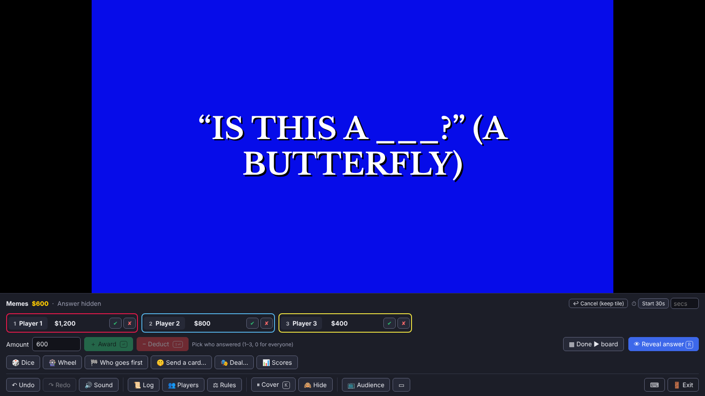
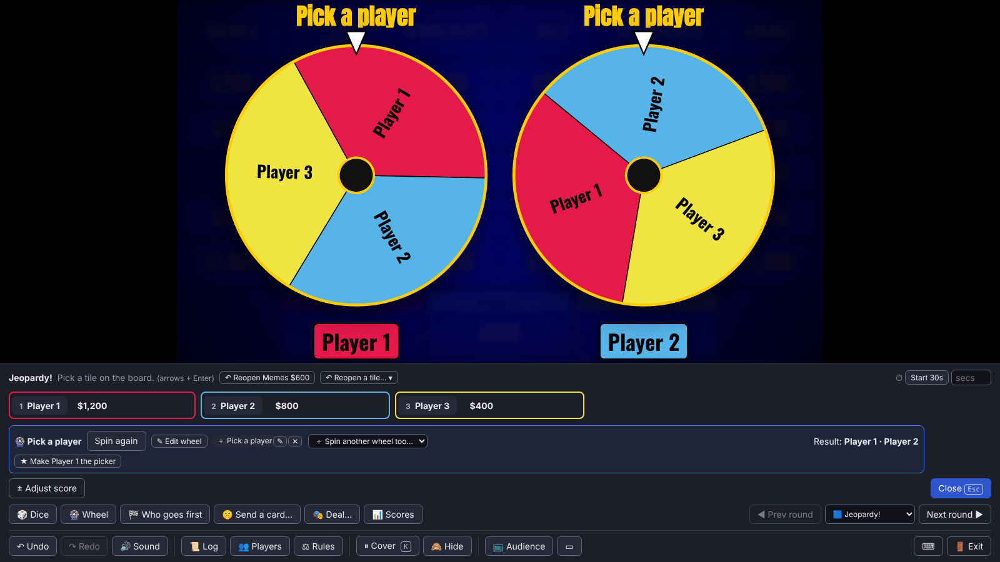
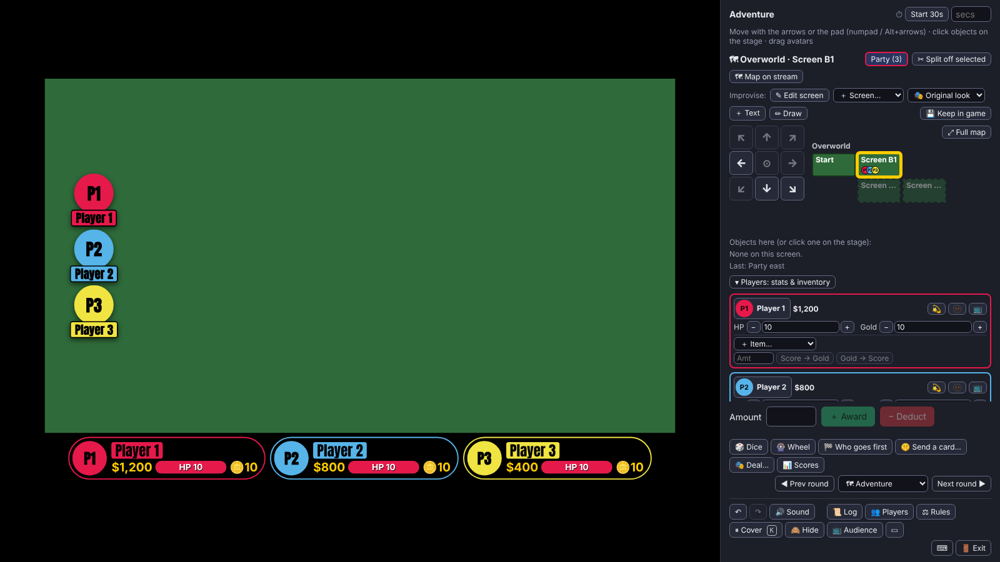
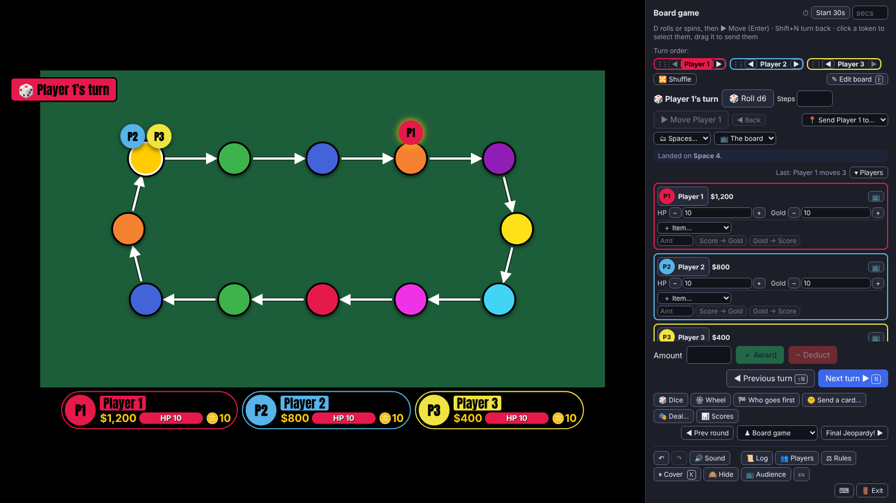

# Brainrot Games Maker

Build and host game shows for livestreams: Jeopardy boards, Final Jeopardy, RPG adventures and board games. The host
runs everything and players answer by voice on the stream, or on their phones.

The whole app is **one HTML file**. Open it in a browser with no install, server or internet. There's also a Windows
desktop app.



## Download

Get it from the **[Latest release](../../releases/latest)** (every push to `main` is released, numbered
`MAJOR.MINOR.PATCH`):

- **`brainrot-game-maker.html`**: double-click it to open it in Chrome, Edge or Firefox.
- **`brainrot-game-maker-portable.exe`**: the Windows desktop app. No install needed.

**Updating.** When a newer version is out, the editor says so (it asks GitHub each time it starts;
⚙ Settings can turn that off, and ℹ About checks any time):

- The desktop app updates itself: **⬆ Update to …** downloads the new `.exe`, checks it's signed with the project's
  key, saves your game and restarts into it, in the same place. (A copy built without the key offers the download.)
  It asks first while a ✎ / 🗜 / 🔄 job runs, and once a game has started it doesn't restart by itself: **⟳ Restart
  into …** in the editor finishes it (if it failed, the editor says why).
- The HTML file offers the new file: save it in place of the old one (same name and folder) and open it. Your games
  carry over: they're kept in the browser, not in the file.

ℹ About shows which version you have.

Old Jeopardy Builder games (`.jbr` packs and exported HTML files) still open.

## Quick start

1. **＋ Add round** and pick a mode.
2. Fill it in. For example, click a tile to type the clue, then **Tab** to the answer and **Ctrl+Enter** for the next
   clue.
3. Press **▶ Play**, then add the players (and set the game rules) on the pre-game screen.

New here? **Try a sample game** on the first screen, or start from a template in **＋ Add round**. **📥 Import clues…**
on a board takes a sheet pasted from Google Sheets or Excel (or a CSV or TSV file chosen or dropped on it), and **Find**
(`Ctrl+F`) searches the whole game.



## Round modes

A game is a list of rounds, and each round has a mode. You can reorder, duplicate or delete any round. **Copy round**
(a round tab's right-click menu) and **📋 Paste round**, or **📂 Import rounds…** (from a .brainrot file, or the web page a
game was exported as), bring a round from another game with the worlds, wheels, dice, stats, items, shops and files it
uses. Where this game already has one of those from another copy of the same game but it differs, the other version
comes in as a copy and this game's stays. A stat of a name and type this game has (HP, Gold) is this game's own, and so
is an item or shop of the same name that's the same otherwise; one of that name that differs comes in named apart
("Potion (copy)").

| Mode | What it is |
|---|---|
| 🟦 **Jeopardy board** | 1–10 categories × 1–10 clues. Supports custom values, Daily Doubles, 🤝 partner clues (placed by hand or 🔀 at random; two players, no buzzers, a steal on a miss if you like, private 🤫 cards you send to their phones or copy to them), 🤫 cards on any tile, and images on categories and tiles. |
| 🏆 **Final Jeopardy** | Private wagers, think music (with phone buzzers, players type their answer on their phone), then a one-by-one reveal and a winner screen; 🤫 cards of its own for the players you choose (＋ Card in its editor). |
| 🗺 **RPG** | Players explore a map of screens. It has stats, items, shops, characters and doorways. |
| ♟ **Board game** | A path of spaces with forks and zones. Players move by dice, a wheel, or one space per turn. |
| 🖼 **Slides** | A few slides in a row (a welcome, the rules, a break); N goes from one to the next. |

Every clue or screen is a **slide**: text, images, GIFs, video, audio or YouTube, arranged freely.

<table>
<tr>
<td></td>
<td></td>
</tr>
<tr>
<td align="center">RPG world editor</td>
<td align="center">Board game editor</td>
</tr>
</table>

**Keyboard and drag:** round tabs, clue tiles, categories, rows, list items and map screens can be dragged and have
right-click menus; `Delete`, `F2`, `Ctrl+D` and `Ctrl+C` / `Ctrl+V` work on what's selected. Files drop onto the slot
they belong in (a picture dropped on a tile asks: in the question, or as the tile's face). Press `?` (or ⌨ in the ⋯
menu) for every editor shortcut. The longer help on the board, a slide, the RPG map and the board game page sits in a
**💡 Tips** fold that stays as you left it.

**Slide editor:** drag a box on an empty spot to select several items. Beside a text box's words counts as empty (until
it's selected), so a full-slide question doesn't move when you meant to select; `Alt`+drag always draws a box. Items
snap to the slide and to each other while moving and resizing (`Alt` turns it off). With several selected, Left /
Center / Right / Top / Middle / Bottom line them up with each other, and **Space evenly** spreads three or more. The
**Layers** list shows whenever the slide has an item, so every item can be reached from the keyboard. Text outlines,
shadows and glows get room inside their box, so they're never cut off at its edge, and **Typewriter (letter by
letter)** types the text out (all at once with reduced motion). The same file added twice is stored once (a toast says
it's already in 🖼 Media). Replacing a file in 🖼 Media redoes the ✎ edits of pictures made from it on the new file.
**✎ Edit…** in 🖼 Media (or ✎ Edit video… on a slide's item, in its panel or its right-click menu) trims a video or
sound, and crops and resizes a video, for every place that uses it; slides' Start at / Stop at move with the trim. Save
as a new file keeps the original too, and from a slide item, Only this item edits it for that item alone. Ctrl+Z puts
the old file back.

**RPG map editor:** drag a screen to move it or swap it with another (dropping past the edge grows the map, dropping
on a map tab moves it there), `Delete` deletes the selected screens, arrows / `Enter` / `Alt`+arrows / `Ctrl+D` /
`Ctrl+C` `Ctrl+V` / `F2` work on the grid, `Shift`-click or a box selects several (`Alt`+drag draws a box from
anywhere, on a full map too), and pictures dropped on the map become screens. Click ⛔ between two screens to block
the way.

**Board game editor:** the board keys the same way. It's one `Tab` stop: the arrows go to the nearest space that way
(`Shift` adds it to the selection), `Enter` opens its settings and `Tab` goes on to them. `Alt`+arrows move the selected
spaces (`Shift`+`Alt` further), `F2` renames, `Ctrl+D` duplicates, `Ctrl+C` / `Ctrl+V` copy and paste spaces with their
buttons (onto any board, in any game), `Delete` deletes. `Ctrl`+click adds a space, `Alt`+drag links two. The
movement dice are kept by the dice themselves, so renaming them in 🎡 Wheels, Dice & Deals keeps them.

Other editor tabs:

- 🔊 **Sounds**: the sounds played on stream (right, wrong, dice, wheel, buzz…): preview, replace or switch each off.
- 🎨 **Theme**: presets, colors, fonts (your own font file too: Fonts › Your own font file) and background images.
  **💾 Save as new theme…** keeps a look in My themes (in this browser, or on this computer in the desktop app) for any
  game; **⬇ Export theme** (a `.brainrot-theme` file) or **📋 Copy theme code** shares it, and **📂 Import theme…** /
  **⌨ Paste theme code…** show someone else's on your board before you use or keep it.
- 🎡 **Wheels, Dice & Deals**: weighted wheels, custom dice and 🎭 deals (a secret part for everyone). Each wheel or
  dice outcome can carry a score effect or action buttons.
- 🤫 **Cards**: private cards made before the show (words, pictures, GIFs, videos, sounds or a link on each), each with
  a name you pick it by. During the show **🤫 Send a card…** sends one to the players you choose: only they see it, on
  their phones. In one window viewers can read a card's name in that dialog (never what's on it), so keep the secret
  on the card.
- 📊 **Stats & Items**: HP bars, currencies, items, wearable gear and shops.

**Copy and paste** slide items or whole slides between clues, rounds and even games; their pictures and sounds come
along.

**Right-click** almost anything for a quick menu. This works on rounds, tiles, map screens, spaces, avatars and items.

**Undo** (`Ctrl+Z`, `Ctrl+Y` to redo) covers every change in the editor and takes you to where it happened. Deleting
doesn't ask first: a "Deleted … · Undo" note brings it back. The **🕘 History** tab lists every change and jumps back to
any point; it survives a reload (⚙ Settings sets how many changes it keeps, 300 by default).



## Hosting

Press **▶ Play** to get to the pre-game screen. Add the players there (rename, recolor, pick a picture, drag ⋮⋮ or
`Alt`+arrows to reorder; type a name and press `Enter` for the next one; they're kept with the game for next time),
open **⚖ Game rules** for scoring, the most players, timers and the round intro, and turn on phone buzzers on the
**📱 Phone buzzers** card (all saved with the game too). `Ctrl+Z` / `Ctrl+Y` undo and redo the changes made there (the
same steps as the editor's 🕘 History, where **Go there** brings you back to this screen). Then pick one of two modes.
Viewers see a "Starting soon…" card until you press **Start game**, which stays at the foot of the window however long
the page gets (on a wide screen the page is two columns). A **🔁 Rematch** keeps the players, their colors and pictures.

- **Single window**: viewers see this window. Press `H` (or **🙈 Hide**) to hide the host controls; **Show controls**
  waits, out of sight, in the top-right corner until the mouse moves (on a touch screen, until a tap, which does
  nothing else). With them hidden, nothing on the stage shows a focus ring until you move the keys yourself (Tab, or the
  board's arrow keys).
- **📺 Separate audience window**: a clean window to capture in OBS or Discord. The host window keeps the answers,
  notes and controls, and its board marks the Daily Doubles (⭐), 🤝 partner and ✍ tiles still to play.

Click a tile to open its clue, then reveal the answer with `R` or a click (a double-click is one step: it never also
shows the answer, or goes back to the board and opens another tile). A clue can have several question slides (a
lead-in, then more: **＋ Add slide** in the clue editor): the main button goes **Next slide ▶** (`N`, `Shift+N` back)
through them first, and the audience window shows the slide you're on. Select players and **＋ Award** (`Enter`) or
**− Deduct** (`Shift+Enter`); on the board the Amount row stays folded behind **± Adjust score** until a player is
selected (pick them with `1`–`9`, then `Enter` takes the keys to the Amount box: type the points, then `Enter`, and the
keys are back on the tile).

The host panel keeps one layout in every round: the status line (with the 📱 phones and ⏱ timer chips and **↩ Cancel
(keep tile)** on the right), the players' score chips, the row of what this moment needs, and at its right the one
main button with its key (**👁 Reveal answer** `R`, **▦ Done ▶ board** `Esc`, **Show question ▶**, **Spin!** `W`,
**Next turn ▶** `N`, the Final's next step `N`…). Under it come the tools (🎲 Dice, 🎡 Wheel, 🏁 Who goes first, 🤫
Send a card…, 🎭 Deal…, 📊 Scores) with the round navigation (◀ Prev round, the round list, Next round ▶) at the right,
then a fixed bar that never moves: **↶ Undo ↷ Redo 🔊 Sound · 📜 Log 👥 Players ⚖ Rules · ⏸ Cover 🙈 Hide · 📺
Audience ▭ · ⌨ 🚪 Exit** (on a narrow window, as their signs only). On a short window (a laptop zoomed in) the round's
own box (✍ answers, the Final's wagers, an RPG round…) keeps a few rows in sight, and the panel scrolls.
Anything that asks first (Exit, closing the audience window, leaving a round, 🔁 Rematch) asks in one strip right
above that bar: Cancel on the left, the answer on the right. Leaving a round always asks, unless a board is played out
(then **Next round ▶** is the main button). In RPG and board-game rounds on a wide window the panel is a column beside
the stage, with the same parts and 🚪 Exit in the bottom-right corner.
The rules can change mid-game too: **⚖ Rules** next to 👥 Players in the host panel opens ⚖ Game rules (they count at once
and are kept with the game), and at the most players 👥 Players offers **Raise Most players**.
Every change can be undone with `Ctrl+Z`, including RPG and board game moves, items and live edits.
Nothing pops up over the stage: questions for the host (a locked door, naming a new screen…) appear in the host panel.
Screen readers hear what's going on: the game starting or resuming, the host panel's status line, who is selected and
who picks next, awards and scores (the Final's reveals too), how the game ended (the winner, a tie to settle,
co-winners), dice, wheel and roll-off results, the countdown and the
scoreboard going on or off, RPG moves (doorways and regroups too) and board-game turns, the buzz order (as it ends up)
and who is answering, a phone's wager coming in (never how much), and the app's notes are announced (politely, a burst of
changes said once, with a window open too). The host's board is one Tab
stop: the arrow keys go from tile to tile. The Stage and the Host controls are named regions, to jump between. In
Windows High Contrast, the selected players and pressed buttons are outlined, while the stage viewers see (and the
editor's previews and theme cards) keeps the game's own colors. On a touch screen, the buttons a row shows when pointed
at (📜 Log's ↶ Back to here, 🕘 History's Go there ›, the ⛔ between screens on an RPG world's map) show anyway.



**Tools, any time:**

- 🎲 Dice
- 🎡 Wheels, including a built-in **Pick a player** wheel (**Pick a team** with phone buzzer Teams). Several wheels can spin at once.
- 🏁 Who goes first
- 📊 Scores (with 📋 Copy standings for chat)

**Phone buzzers** (Buzzer mode, on the pre-game screen's 📱 Phone buzzers card, saved with the game): start the room
and share the code, link or QR code (it's on the viewers' Starting soon card too). Players open the link on their
phone, tap their name and get a big BUZZ button, Jackbox-style; new players can ask to join from their phone if you
allow it (until the game has its most players). With **Teams** on, each player is a team: people pick their team on their phone and type their own name, and
whoever on it buzzes first answers for the team ("Ann (Red team)" in the buzz order); a wrong answer locks out the
whole team. A room holds up to 24 phones at once: once 24 people are on teams, the next phone is told the game is full
until someone leaves. On a Daily Double or a Final, players type their wager on their phone and send it: it fills in your
wager box (marked 📱, and you can still change it), they can change it until you show the question, and only you see
how much (in one window, where viewers see your panel, a Daily Double's stays hidden there until **Show wager**). In a Final they then type their answer on their phone too (or tap one of its multiple choices), and you
reveal each one on stream. On a ✍ Everyone answers clue nobody buzzes: everyone types an answer on their phone, or
taps one of its multiple choices (shown on stream under the question too), and only you see what they sent (once you
judge one, that player can't change it). The buzzers open when the clue does, or when you press `U` after reading it.
The fastest reaction wins, timed on each player's own phone, so a slow connection doesn't cost anyone the buzz. Every
buzz is listed in the host panel, fastest first: a wrong answer locks that player out (struck out where they are in the
list) and the next one who buzzed answers at once, in bold (**⏭ Skip** passes them on with no points taken); once nobody
who buzzed is left, the buzzers open for the rest, and **↺ Reset buzzers** (`0`) lets everyone buzz again. Buzzes
within 0.01 s are a tie: **🎲 Roll for it** sets who answers first (the roll leaves the stage once you judge, skip or
take the next in line), or pick one yourself (`1`–`9` or a click always picks by hand). Viewers
see "🔔 Ann is answering" whenever one player is picked during a clue. Phones also say who got a clue right (a Daily
Double too) and what's on (a Daily Double's player sees "you're up"; on a 🤝 partner clue every phone's button greys
and says who describes and who guesses), beep and flash when BUZZ! lights up (🔔 mutes), and **Not you?** lets a
player change seats. A long question fits the phone: its text gets smaller (down to a size that's still easy to read)
and past that it scrolls, with ▼ More.
🤫 Cards go to a player's phone through the buzzer server, only when you send them (📤 in the
partner clue's panel): their words, links, pictures and videos, your own files included (pictures are shrunk first;
a big GIF, video or sound can go as a smaller copy for phones: **🗜 Make smaller…** on its card in 🖼 Media, or
**🗜 Make smaller** on the host panel's line about it during the game, see Card files under
[Set up your own buzzer server](#set-up-your-own-buzzer-server)).
The phone shows a card in place of the buzz button, behind **Tap to see** (🙈 Hide covers it again), and the panel says
✓ seen once it's opened. YouTube, Drive and Streamable videos play in their own player when tapped. The buzzer server
keeps a card until the tile closes (or the round ends, or you take it back, for one sent with 🤫 Send a card…), and
the card's pictures and videos up to 10 minutes longer. A phone that takes
the seat or joins the team after a card went out doesn't get it: the panel says so, and ↻ Send again gives it to it.
After **Exit › Keep & leave** the cards out stay on the phones until you resume the game (or discard it).
With teams, **☐ Partner from the same team** (or the wheel landing on the picker's own team) spins a wheel of that
team's people: the card goes to the one who describes, the rest of the team is told who's describing, and the team
scores once. On an older buzzer server, or for a player without a phone, you copy the card to them (📋).
With **A miss on a partner clue lets the others steal it** (⚖ Game rules, or each clue's own **After a miss**), ✘ Missed
opens the buzzers for everyone else, the two who missed it locked out (without phones you pick who steals, `1`–`9`):
a right steal gets the tile's value, a wrong one loses it, as on any clue, and Ctrl+Z on the miss closes the steal.
**🤫 Send a card…** in the tools row sends a card to any players, teams or people on a team, at any time and in any
round: one of your 🤫 Cards, a tile's or a Final's card made in the editor, or a quick one (words typed or pasted, with
a picture, video or sound, or a link). It lasts until the round ends or until you take it back; **🤫 2 cards out** next
to it lists them by the name the app gives each ("Card 2 → Ann", never what's on it) with ↻ Send again and ✖ Take back;
it turns orange when one isn't all on the phones (a picture that didn't go up, a phone that came late), and that card's
row says what. A card made in the editor that you change after it went (▶ Resume with my edits) comes off the phones
until you ↻ Send it again, keeping its place among the cards the phones hold meanwhile.
Any tile can have 🤫 cards (＋ Card in the clue editor): a standard or Daily Double tile's are offered in its panel to
the player who picked it (a private question, a tip before the wager), go only when you send them, and go away when the
tile closes; the tile plays as it always does. A Final can have 🤫 cards too (＋ Card in its editor): its panel offers
them from the wager screen to the last reveal, each starting with everyone playing it (the chips change who gets it;
teams go whole), they go when you press 📤 Send, and they go away when the Final ends (during the wagers, and during
the question while players type their answers, a card sits above the wager or answer box on the phone, so one or two
per player keep that box in sight). Give a tile's or a Final's card a name (**Card name** on the card's bar; F2 on
its tab) to tell them apart: its tab, the host panel and 🤫 Send a card…
show it instead of "Card 2". Phones never get it, but in one window viewers can read it in the host panel, so call a
card what it's for, never what's on it. An RPG object, an item, a wheel slice, a die face or a board space can
have a **🤫 Send a card** button (who gets it: whoever set it off, the party, a player you pick then, or everyone else):
pressing it in play only offers the card in the panel, and it goes when you press 📤 Send there (Skip sends nothing).
For a player with no phone, **🪟 Card window** (in 🤫 Send a card…) opens a window with only that player's cards,
pictures and videos included, to share with them alone (a Discord DM call) or show them on a second screen. With no
phones getting cards, 🤫 Send a card… and an action's offer put a card there with **🪟 Show**. Viewers never get it:
share only the game window.
**🎭 Deal…** next to it hands everyone a secret part, each on their own phone: 🕵 Odd one out (one spy, everyone else
gets the same location from a wheel), 🐺 Secret roles (a wolf, a seer, villagers), 🧢 Team captain (one on each team)
or 🧠 Everyone's own prompt (a slice of a wheel each), or a deal of your own made in the editor's 🎡 Wheels, Dice & Deals tab (parts with a
card each and how many get it). 🎭 Deal shuffles the parts (with the audience window open you can choose who gets one,
and the column beside the stage shows who got which); nothing goes until you press 📤 Send, which sends each player's
card on its own, their part ("You're the Spy") on it behind Tap to see. In one window the panel only counts the parts
("Spy ×1, Villager ×4") and lists everyone dealt in alike, a part or not (with the phones getting the cards, those with
no phone here, 📵, to copy theirs). ↻ Send again and ✖ Take back work on the whole deal, and **🎭 Who was who** puts
everyone's part on screen when you choose (a click on it, Esc or Ctrl+Z takes it off, and so does opening a tile or
the tiebreaker, going to another round, or the Final going on).
A player on a computer opens the same link: `Space` (or `Enter`) buzzes, `1`–`9` pick their seat or team, `Esc` goes back, and the page says when another window (the stream, say) has the keyboard. The room stays open
through the pre-game screen, a reload of it or of the game (▶ Resume it on the pre-game screen, or Resume game, goes back into it unless a phone joined a room started there: one nobody joined closes on ▶ Resume it or ◀ Back to editor), **◀ Back to editor**, **Exit › Keep & leave** (Resume goes back into it)
and **▶ Next game…** (▶ Play asks to keep it for another game, which then has its players, and Teams on if it was); it closes with **Exit › Discard & leave**, when you leave the results screen any other way than
▶ Next game…, with **✕ Close the room**, or when Buzzer mode is turned off (not by undoing, in the editor, the step ▶ Play
made to turn it on for the room). The join code shows small in a corner of the stream
during the game (at the end of the score bar on the board) and on the cover card; the On stream options can hide it.
**🔒 Lock seats** keeps new phones out, and a player whose seat you take back (✕) can't take it again for 2 minutes.
The rooms run on a small buzzer server
(`buzzer/`, a Cloudflare Worker); the release builds come with one, and ⚙ Settings › Buzzer server can point at your
own ([Set up your own buzzer server](#set-up-your-own-buzzer-server): free, about 10 minutes). Copies built without one say "Phone buzzers aren't set up in this copy", and play a game saved with Buzzer mode
on without it (you pick who answers); the setting stays with the game for a copy that has a server.

**Sounds** are built in and on by default (right, wrong, dice, wheel, buzz, reveal, and an RPG's quiet steps,
doorways, pick-ups, coins and damage…): preview, replace or switch each
off in the editor's 🔊 Sounds tab (↺ goes back to the built-in sound; a sound switched off keeps the file chosen for it).
The players and rules aren't there: the tab says so at the top, with a button to the ▶ Play screen.

**For OBS:** Theme › Stage background can be chroma green or magenta for keying (the pre-game screen warns when a
player's color is close to the key, which would key it out, and the Theme page and the pre-game screen name the theme's
colors OBS would make see-through, such as Brainrot Neon's green values on the green key, and the pre-game screen also a
board game's backdrop, spaces and zones or RPG screens it would, such as a new board's green backdrop; the Daily Double
splash and 🤝 PARTNER UP! take colors the key leaves alone), and **▭** (or `Shift+A`) opens a
scores-only window for a lower-third capture. Capture these windows with OBS's **Window Capture**: a Browser source
runs in OBS's own browser, which can't reach the host page. The "Starting soon" and cover cards can be edited, with a
countdown (the host sees its time left). **Reduce motion on stream** is in the pre-game screen's On stream section too.

**Made to read on a scaled-down stream** (720p or 480p in Discord): scores shrink to fit their plates and long names
end in "…" instead of being cut off, a board's values share one size that fits its columns, category names never get
smaller than about 30 stage pixels (very long words are hyphenated; the editor's checklist says when a name is too long
for the board), the countdown and "🔔 Ann is answering" move the question down instead of covering its first line,
and score pops stay on screen. New players get colors that stay apart for color-blind viewers (the first 8); a game
keeps the colors it was saved with. The winner's confetti is a short burst beside the standings (none with Reduce
motion on stream).

**Single-window mode shows viewers everything on screen**, including wagers as you type them, answers, host notes and
hidden objects. Use the separate audience window when that matters.



**RPG rounds** have these controls:

- The stats strip along the bottom never covers the screen: the screen is scaled into the room above it (past 6
  players the strip is one row of compact cards). The map on stream is solid, and the players' dots on it carry their
  initials.
- A movement pad, and a minimap that expands to the full map so you can jump the party anywhere. On a big world the
  minimap shows the screens around the party; the arrow keys go from screen to screen on it.
- The map on stream (`V`) shows only what viewers know, with a cell around it, and says when the party is on a map
  hidden from them.
- Split and regroup parties. An object's "the party" buttons act on the party standing at that object.
- Player cards with stats and inventory.
- Shops.
- Live improvising: edit the screen, add text, or draw objects on a drawpad.
- Select several players and objects (click avatars, `Shift`+click objects) and drag them together: the group keeps
  its shape, and one drag is one undo step.

**Board game rounds** have these controls (as in RPG rounds, the board is scaled into the room above the stats
strip, so no space is ever under it; the turn banner does go over the board's top edge, and the editor's checklist
notes a space up there):

- Roll (or spin the movement wheel) and move, picking the way at each fork. A wheel's slice or a die's own face moves
  as far as the number it names ("3", "Move 3"; "Back 2", "Go back 2" or "◀ 2" move back). Moving back goes back the
  way the player came.
- Send players to any space.
- Each space's actions, for the player they're for (the one who landed there, or the ones picked on its card).
- **✎ Edit board** (`E`) while you play: add, move, connect, rename and delete spaces (players on a deleted space go to
  the one before it); `E` or `Esc` again goes back to playing.

<table>
<tr>
<td></td>
<td></td>
</tr>
</table>

**Ties** for first aren't called a win on stream until they're settled, in one of three ways:

- A roll-off, whose winner wins the game (`O` on the results screen).
- A tiebreaker clue: select the winner and ＋ Award. Its Amount starts at 0, so settling the tie adds no points.
- Co-winners.

The winner fanfare plays once the tie is settled. Each way settles only the tie it was used for: a score fixed later
into a tie with someone else opens it again.

**Exit** keeps the game in progress, and **Resume game** picks it up later, even after a crash. Resume asks how the
game is shown, **Single window** or **📺 Separate audience window** (the same choice as before the game), and a game
left with the screen covered comes back covered.

### Keyboard shortcuts

The main ones (press `?` before or during the game for all of them, starting with the ones for the round or screen
you're on):

| Key | Action |
|---|---|
| `1`–`9` | Select player N |
| `P` then `1`–`9` | Make player N the current picker |
| `Enter` / `Shift+Enter` | Award / deduct |
| `R` | Reveal / hide the answer (the countdown stops) |
| `←` `↑` `→` `↓` on a tile | Move across the board (`Enter` opens the tile; after a clue the keys go on from its tile) |
| `Esc` / `Shift+Esc` | Back to the board / cancel the clue (the tile stays playable) |
| `N` / `Shift+N` | Next step (intro, a clue's next slide, Final, next turn) / the one before |
| `C` / `X` | Final reveal: right / wrong |
| `T` / `Shift+T` | Start/pause the timer / 10 more seconds |
| `D` / `W` / `O` / `S` | Roll the last dice again (a board game's own dice) / wheel / roll-off (on a tie for first: the tied players) / scoreboard |
| `K` or `B` | "Be right back" cover (every round): the countdown and the clue's video wait under it |
| `0` | Select everyone or no one (in buzzer mode, during a clue: reset the buzzers) |
| `U` | Buzzer mode: open the buzzers (when they open on your key) |
| `A` / `Shift+A` | Open (or focus) the audience window / the scores-only window |
| `L` | Log: the history (go back to any point), scores and rolls |
| `H` | Hide / show the host controls |
| `F` | Full-screen |
| `Space` / `←` `→` / `M` | Play/pause, seek, mute media |
| `Y` | Open YouTube / online media in its own window |
| `Ctrl+Z` / `Ctrl+Shift+Z` | Undo / redo |
| `J` / `V` / `G` (RPG) | Full map / map on screen / regroup everyone here |
| `I` (RPG, board game) | Player sheet |
| Arrows, numpad or `Alt`+arrows (RPG) | Move the party |
| `E` (board game) | ✎ Edit board while you play |
| `?` | Every key |

A key held down counts once (only the arrows repeat). With the keys on the main button in a slides round, or on a
round's title card, `Enter` does what the button says, as `N` does. An `Enter` right after a Daily Double's question
goes up doesn't judge its player yet: press it again.

## Saving

- **Save** (`Ctrl+S`) writes a `.brainrot` pack: the game plus all its media.
  - In the desktop app, saves go in a **BrainrotSaves** folder next to the `.exe` (in Documents\BrainrotSaves when the
    app may not write there, e.g. in Program Files). Closing the window while a save is being written asks whether to
    wait for it. While autosave can't write (a full disk), closing the window asks first too, as a browser tab does.
  - In a browser, they're downloads. A file over 100 MB asks where to save it instead (Chrome, Edge), so a big download
    can't fail unnoticed.
  - Changes made while a save is being written aren't in it, so they still count as unsaved.
- **Open…** lists your **Recent games** and, in the desktop app, BrainrotSaves. It also opens `.json` games, exported
  HTML files and the desktop app's `.bak` backups. Dropping a game file (`.brainrot`, `.zip`, `.json`, `.html`) on the
  editor opens it (a `.brainrot-theme` file opens on the 🎨 Theme page), and the desktop app opens a game, a `.bak` or
  a theme file you open it with ("Open with", or dropped on the `.exe`). One given during a game opens when you're
  back in the editor.
  - **Recent games** keeps the last 8 games New or Open… replaced (about 1 GB of files at most), with their undo
    history. When one has to go to make room, the app says which. Two versions of one game are both kept. A game with
    only a title isn't kept. **🗑 Delete** asks first: it deletes the kept copy and its files.
  - Opening an older copy of a game never changes the pictures and sounds of the game you have open: a file that
    differs is opened as a file of its own.
- New and Open… ask **Cancel / Open anyway / Save first** (or **Start new anyway**) when the game has unsaved changes
  (Open… checks the file is a game first); going on anyway keeps the old game in Open… → Recent games. Only one browser tab edits at a time: another tab waits, paused, and offers **Edit here** once the
  editing tab closes.
- **⋯ → ⬇ Export as a web page…** (Export HTML) makes a single file to play the game from, without this app, with everything inside. It shows the answers, so keep
  it to yourself. Every file in 🖼 Media goes in, used or not: a big file's size question says how much of it is
  files nothing in the game uses (**🗑 Delete unused** leaves them out). A game over about 375 MB is too big for one
  HTML file (browsers can't read it back): save a `.brainrot` instead.
- Add pictures, videos, sounds and fonts on the **🖼 Media** page: drop them there, or use **＋ Add files…**. A video or
  sound this browser can't play is offered a fix as soon as it's added (🔄 Convert: repackaged in seconds with nothing
  lost when only its file type is the problem, as with an MKV, or an .mts whose sound plays here; a camcorder's .mts
  usually loses its Dolby Digital sound), and Ctrl+Z puts the old file back.
- **⚙ Settings** (in the header's ⋯ menu, with Export as a web page, Export JSON, ⌨ Keyboard shortcuts, 📖 How to host
  (this guide) and ℹ About) has these options:
  - **Reduce motion on stream** (the editor, the host controls and your own copy of the stage beside the audience
    window also follow your computer's reduce-motion setting).
  - **Undo**: how many changes Ctrl+Z and the 🕘 History tab remember (300 by default).
  - **Autosave** every few minutes (desktop app). The default is every 5 minutes, keeping the last 3.
  - **Save replaces the game's last save** and keeps the two before it as `.bak` / `.bak2` (desktop app, on by
    default); off makes `Game (2)`, `Game (3)`… instead. Autosaves are kept per game.
  - **Buzzer server**: where phone buzzer rooms are made, with a **Test** button (the release builds come with one).
    An exported HTML file keeps the server it was exported with. Its **How to set up your own** link opens
    [Set up your own buzzer server](#set-up-your-own-buzzer-server).

## Set up your own buzzer server

Phone buzzers need a small server where the host and the phones meet. The release downloads come with one, so most
people never need this. Set up your own if your copy says **"Phone buzzers aren't set up in this copy"**, if you built
the app yourself, or if you'd rather not depend on someone else's. It runs on **Cloudflare Workers, free**: no credit
card, and it stays well within the free plan's limits for game nights.

You need about 10 minutes, a computer with a terminal (Windows: PowerShell), and:

- a free **[Cloudflare account](https://dash.cloudflare.com/sign-up)**;
- **[Node.js](https://nodejs.org/)** 20 or newer (the LTS download is fine);
- this project's files: **Code → Download ZIP** on the GitHub page (then unzip it), or `git clone` it.

**1. Install the server's tools.** Open a terminal in the project's folder, then:

```sh
cd buzzer
npm ci
```

**2. Log in to Cloudflare.** This opens your browser; click **Allow**.

```sh
npx wrangler login
```

**3. Publish the server.**

```sh
npx wrangler deploy
```

The first time, Cloudflare may ask you to pick a `workers.dev` subdomain (any name you like, once per account). When
it's done it prints the server's address, like:

```
https://brainrot-buzzer.your-name.workers.dev
```

**4. Point the app at it.** In the app, open **⋯ → ⚙ Settings**, paste that address into **Buzzer server**, and press
**Test**: it should say **✔ The buzzer server is answering**. That's it: on the ▶ Play screen, the **📱 Phone
buzzers** card can now open a room. (The address is kept on this computer; one typed without its `https://`, as
Cloudflare's dashboard shows it, gets it. A game exported as a web page keeps the server it was exported with.)

**Updating it.** When a new version of the app comes out, get the new files and run `npx wrangler deploy` in `buzzer`
again (step 1's `npm ci` too if it's a fresh download), ideally not in the middle of a game: phones reconnect by
themselves, but a buzz in flight could be lost. Older and newer copies of the app keep working with it.

**Or let GitHub do it.** If you keep your own copy (a fork) of this repository on GitHub, every push to `main` can
publish the server for you: add two repository secrets under **Settings → Secrets and variables → Actions**:

- `CLOUDFLARE_ACCOUNT_ID`: in the Cloudflare dashboard, **Workers & Pages** (on the right-hand side).
- `CLOUDFLARE_API_TOKEN`: **My Profile → API Tokens → Create Token**, with the **Edit Cloudflare Workers** template.

To build the address into your own releases too (so nobody has to paste it), add a repository **variable**
`BUZZER_URL` with the server's address.

**If something's wrong:**

- **Test says "No answer from there"**: check the address (it starts with `https://` and ends in `.workers.dev`),
  and that the deploy finished without errors. A new `workers.dev` address can take a minute or two to start answering.
- **`npx wrangler login` doesn't open a browser** (on a remote machine, say): run `npx wrangler login --browser=false`
  and open the link it prints.
- **The deploy asks about Durable Objects or a plan**: the free plan is enough; this server uses the kind of Durable
  Objects the free plan includes.
- If the free plan's daily limits are ever reached, new buzzes stop until the next day's reset. It never charges you.
- **Card files** (the pictures and videos hosts send to phones on 🤫 cards) are 90 MB each at most and 900 MB a room by
  default, just under what Cloudflare's free plan allows, and count against a budget for the whole server, 4,000 MB in
  any 24 hours by default; past it, hosts copy those to their players (📋) until it frees up again. Change them with
  `FILE_MB`, `ROOM_FILES_MB` and `FILES_MB_PER_DAY` in `buzzer/wrangler.jsonc` (`FILES_MB_PER_DAY` `0` turns card files
  off), then deploy again: the app asks the server, so it follows on its own, and ⚙ Settings › Buzzer server › Test says
  what it takes. A file over 16 MB that the server takes still goes, with a note in the editor and the host panel that
  phones on mobile data may wait a while for it. A big GIF, video or sound can go as a smaller copy instead: **🗜 Make
  smaller…** on its card in 🖼 Media (or 🗜 in the 📱 preview or the checklist) makes one, which phones get while the
  show keeps the file as it is (Ctrl+Z takes it back): a GIF as a small looping video that phones show like the GIF, a
  video at 720p, 480p or 360p, a sound made again, and a video or sound can hold only the part its cards play. 🖼
  Media's **🗜 2 files are big for phones** makes copies of all of them at once. A .mov or MKV that plays here but phones
  can't open is repackaged for them with **↻** instead (in its place, for the show too, nothing lost; Ctrl+Z undoes it),
  and a video or sound phones can't play that can't be repackaged (a FLAC, say) can get a copy they can (🗜). During the
  game too: the host panel's line about a card's big files, the pre-game checklist's and the host column's have
  **🗜 Make smaller**, for the game being played (the editor's game keeps the copy as well; a card already out switches
  over to it). In one window its window names no file and shows no preview, and mid-game it opens in the host panel,
  never over the stage. A copy that still comes out too big for the server (an encoder can go over on a busy picture)
  says so, and 🗜 again offers only copies smaller than it (a smaller picture, or only the part the cards play), their
  sizes as far over; where none can be (a GIF's, or a sound's its cards play all of), it says to add the file from a
  link. It works the computer hard for a minute or two, so the stream may stutter: it's best done in the editor before
  the show. It needs the app opened from a file or an https:// address, in Chrome, Edge, Firefox or the desktop app;
  where the browser makes H.264 and AAC (Chrome and Edge on Windows or Mac, the desktop app) it makes MP4 and M4A files
  every phone plays, elsewhere WebM and OGG (Opus), which some iPhones may not play.
  See [buzzer/README.md](buzzer/README.md#card-files). Each room keeps
  its cards only until the tile closes (or the round ends, or the host takes it back, for one sent with 🤫 Send a card…),
  and their files up to 10 minutes longer (20 hours after their upload began at most: the app puts one up again if a
  card still needs it).

More about how the server works (fair timing, limits, local testing) is in [`buzzer/README.md`](buzzer/README.md).

## Streaming the sound (Discord, OBS)

In dual-window mode, the sound plays from the **audience window**. **🔊 Sound** in the host panel has a **Test sound**
button, a speaker picker (e.g. for a virtual cable into OBS), and step-by-step help.

**Discord:**

1. **Share Your Screen › Applications**.
2. Pick the audience window, with **Sound** on.
3. If viewers hear nothing, turn on Discord's *experimental method to capture audio* (**Voice & Video › Screen Share**)
   and restart Discord.

**Desktop app:**

- Don't run it as administrator or with compatibility settings. Discord and OBS can't hear it then.
- The **Discord audio fix** is on by default. Switch it off in the 🔊 Sound help.
- If the window stays blank, turn the fix off in either of these ways, then reopen the app:
  - Start the app with `--no-audio-fix`.
  - Create an empty file named `discord-audio-fix-off` in `%APPDATA%\com.brainrotgames.maker\`.

  ```bat
  mkdir "%APPDATA%\com.brainrotgames.maker" 2>nul & type nul > "%APPDATA%\com.brainrotgames.maker\discord-audio-fix-off"
  ```

The desktop app keeps its data in `%LOCALAPPDATA%\com.brainrotgames.maker`: the game you're editing, Recent games, a
game in progress and media. Settings go in `%APPDATA%\com.brainrotgames.maker`. Your saves, exports and autosaves are in
**BrainrotSaves** next to the `.exe`. **ℹ About** shows and opens all three. To uninstall, delete the `.exe` and the two
`com.brainrotgames.maker` folders; keep BrainrotSaves (or move it) if you want your saved games.

## Third-party code

Two libraries are bundled into the app as they are:

- [mediabunny](https://github.com/Vanilagy/mediabunny) 1.61.6, © 2026-present Vanilagy and contributors, under the
  Mozilla Public License 2.0 (its source is at github.com/Vanilagy/mediabunny): 🗜 (smaller copies of 🤫 cards' files
  for phones), 🔄 Convert, ✎ Edit and the check whether a video or sound plays here use it. It reads videos and sounds,
  and writes the copies, converted and edited files (repackaged as they are, or made again with the browser's own
  video and sound encoders, WebCodecs).
- [omggif](https://github.com/deanm/omggif) 1.0.10, © 2013 Dean McNamee, under the MIT license: 🗜 uses it to read a
  GIF's frames. Its license:

  > Permission is hereby granted, free of charge, to any person obtaining a copy of this software and associated
  > documentation files (the "Software"), to deal in the Software without restriction, including without limitation
  > the rights to use, copy, modify, merge, publish, distribute, sublicense, and/or sell copies of the Software, and to
  > permit persons to whom the Software is furnished to do so, subject to the following conditions:
  >
  > The above copyright notice and this permission notice shall be included in all copies or substantial portions of
  > the Software.
  >
  > THE SOFTWARE IS PROVIDED "AS IS", WITHOUT WARRANTY OF ANY KIND, EXPRESS OR IMPLIED, INCLUDING BUT NOT LIMITED TO
  > THE WARRANTIES OF MERCHANTABILITY, FITNESS FOR A PARTICULAR PURPOSE AND NONINFRINGEMENT. IN NO EVENT SHALL THE
  > AUTHORS OR COPYRIGHT HOLDERS BE LIABLE FOR ANY CLAIM, DAMAGES OR OTHER LIABILITY, WHETHER IN AN ACTION OF CONTRACT,
  > TORT OR OTHERWISE, ARISING FROM, OUT OF OR IN CONNECTION WITH THE SOFTWARE OR THE USE OR OTHER DEALINGS IN THE
  > SOFTWARE.

ℹ About says so too, with omggif's license.

## Development

```sh
npm install
npm run dev            # dev server
npm run build          # → dist/index.html (one self-contained file)
npm run check          # type-check
npm test               # unit tests
(cd buzzer && npm ci)  # once: the buzzer server's packages (its e2e tests run it)
npm run test:quick     # the quick end-to-end test (about a minute; CI waits for it before releasing)
npm run test:e2e       # the full end-to-end suite (about 25 minutes in CI; CI runs it alongside the release)
npm run test:buzzer    # only the phone-buzzer end-to-end files (they start a local buzzer server)
npm run screenshots    # regenerate docs/screenshots (build first)
npm run desktop:build  # Windows app (needs Rust + Tauri prerequisites)
```

The stack is Svelte 5, TypeScript and Vite, bundled into a single file. The desktop app is [Tauri](https://tauri.app)
(`src-tauri/`). Specs are in [`docs/SPEC.md`](docs/SPEC.md) and
[`docs/GAMES-MAKER-SPEC.md`](docs/GAMES-MAKER-SPEC.md).

| Path | What's there |
|---|---|
| `src/lib/` | Model, game flow and scoring, tools, media, saving, RPG (`rpg.ts`) and board game (`boardgame.ts`) logic |
| `src/editor/` | The editor |
| `src/play/` | Hosting: the stage, host panel, RPG and board game play |
| `src/audience/` | The audience window |
| `src-tauri/` | The desktop app |
| `tests/e2e/`, `scripts/` | Browser tests, the screenshot script and the version script |

### Versions and releases

Versions follow [Semantic Versioning](https://semver.org). Every push to `main` is released by CI as `vX.Y.Z`
(`.github/workflows/build.yml`), numbered by `scripts/version.mjs` from the last release and the `CHANGELOG.md`
lines the push adds:

- only lines under **Fixed** → a patch (1.4.2 → 1.4.3);
- anything under **Added**, **Changed** or **Removed** → a minor (1.4.2 → 1.5.0);
- a line marked **Breaking** (e.g. saves older versions can't open) → a major (1.4.2 → 2.0.0).

`package.json`'s version is a floor: raise it by hand (`node scripts/version.mjs set 2.0.0`) for a deliberate step.
`node scripts/version.mjs check` makes sure `package.json`, `package-lock.json`, `src-tauri/tauri.conf.json`,
`Cargo.toml` and `Cargo.lock` agree. The release notes are the changelog lines added since the last release.

**Signing the desktop app's updates** (once): the desktop app only installs an update signed with the project's key.

1. `npx @tauri-apps/cli signer generate -w ~/.tauri/brainrot-update.key` (works from any folder; pick a password;
   keep the key file private and backed up: without it, installed copies can't update themselves any more).
2. In the repository's Settings › Secrets and variables › Actions: secret **`UPDATE_SIGNING_KEY`** = the key file's
   contents, secret **`UPDATE_SIGNING_KEY_PASSWORD`** = its password, variable **`UPDATE_PUBKEY`** = the public key
   it printed (also in `brainrot-update.key.pub`).

Without them CI still releases, unsigned, and the desktop app offers the download instead of updating itself.
