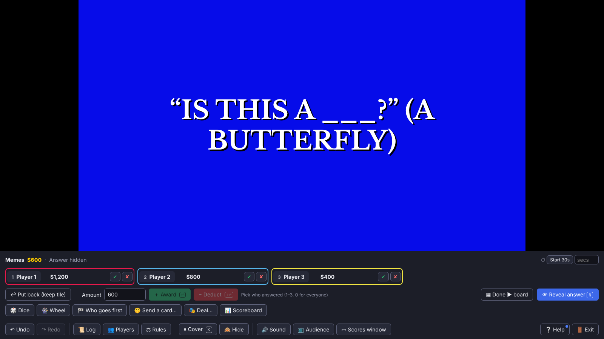
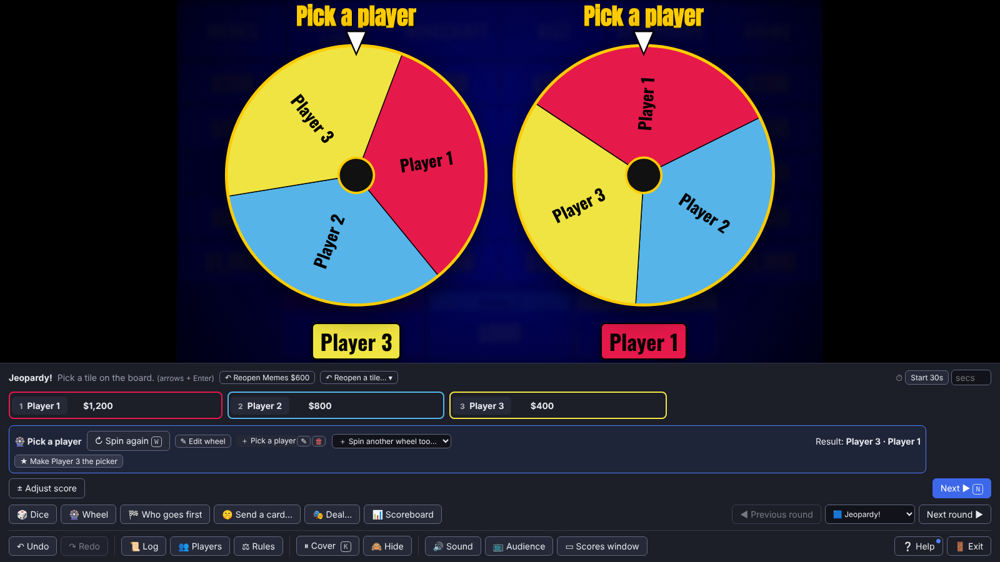
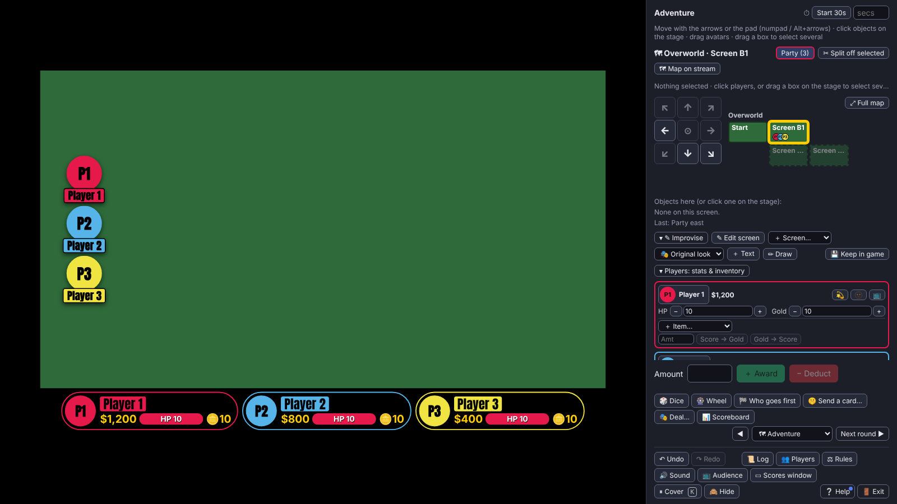
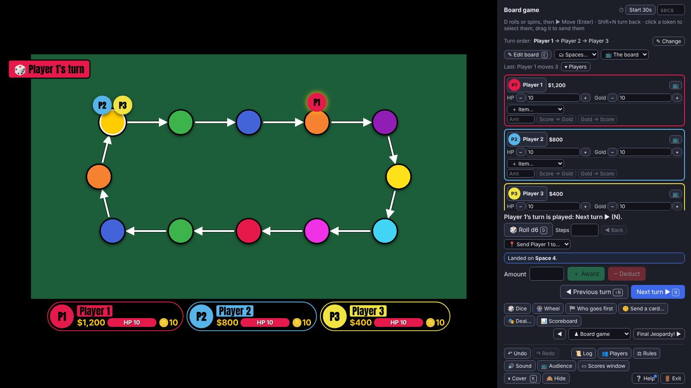

# Hosting a game

[← Back to the README](../README.md)

How to run a show. For every key, see [Keyboard shortcuts](keyboard-shortcuts.md).

## Before the game

Press **▶ Play** to open the pre-game screen. Everything you set here is saved with the game.

### Players

- Type a name and press `Enter` to add the next player.
- Drag a row's ⋮⋮ handle, or press `Alt`+arrows, to reorder.
- Right-click a row for its color, picture, start score, rename and delete. `F2` renames.
- **± Start scores** sets the points a player has before the first clue.
- `Ctrl+Z` and `Ctrl+Y` undo and redo changes on this screen.

### Rules

**⚖ Game rules** holds scoring, the most players, timers and the round intro. Mid-game, open it from **⚖ Rules** in the
host panel.

### Before you start

The **✅ Before you start** list shows two groups:

- **On stream**: the audience window, the phone room and sound (**🔊 Test the sound…**).
- **The game**: things worth fixing, each with **Fix ›** to that place in the editor. They're only warnings.

### Pick how viewers see the game

| Mode | What viewers see | Use it when |
|---|---|---|
| **Single window** | This window. Press `H` to hide your controls. | You share one screen and don't mind viewers seeing your panel. |
| **📺 Separate audience window** | A clean window for OBS or Discord. Your window keeps the answers, notes and controls. | You stream. Recommended. |

In two-window mode, **📺 Open it now** (or **Start game**) opens the audience window. Click it once so it can play sound.

> **Single window shows viewers everything on screen**, including wagers as you type them, answers, host notes and
> hidden objects. Use the separate audience window when that matters.

Until you press **Start game**, viewers see a "Starting soon…" card.

### Resuming a game

A game you left with **Exit › Keep & leave**, or one interrupted by a reload or crash, shows at the top of the
pre-game screen with **▶ Resume it**. **Start game** asks before discarding it.

**🔁 Rematch** on the results screen starts again with the same players, colors and pictures.

## The host panel

The panel keeps the same layout in every round:

1. **The status line**: what's happening and what to do next.
2. **Score chips** for each player.
3. **The action row** for this moment, with the **blue button** at its right.
4. **Tools**: 🎲 Dice, 🎡 Wheel, 🏁 Who goes first, 🤫 Send a card…, 🎭 Deal… and 📊 Scoreboard, with the round
   navigation (◀ Previous round, the round list, Next round ▶) on the right.
5. **A fixed bar**: ↶ Undo, ↷ Redo, 📜 Log, 👥 Players, ⚖ Rules, ⏸ Cover, 🙈 Hide, 🔊 Sound, 📺 Audience, ▭ Scores window,
   ❔ Help and 🚪 Exit.

### The blue button

The blue button (`N`) is always the show's next step: the round intro, the next slide, **👁 Reveal answer**,
**▦ Done ▶ board**, **Next round ▶**, and so on. Buttons that give points, open buzzers or roll dice are never blue;
they have their own places. `Shift+N` goes back one step.

### The check before going on

If something is still left when you press the blue button (no points given, a wheel not spun, answers not judged), a
small card opens in the panel with a button to fix each one.

- `Enter` does the suggested fix.
- `N` again goes on anyway (except into an answer: press `R` for that).
- `Esc` is **Not yet**.
- `Shift`+click on the blue button skips the check.
- "Don't ask about … again this game" turns one kind of check off. The keys window (`?`) lists what's off, with
  **Ask again**.

Other questions (Exit, leaving a round, Rematch) appear in a strip above the fixed bar. Nothing pops up over the stage.

### Clicking the stage

A click on the stage does the blue button's step, or what the stage shows: spins a wheel, rolls dice, moves a token.

### Menus

Right-click (or `Shift+F10`, or a long press) for a menu.

- **A player**, anywhere on the host screen: this moment's actions for them, then **★ Make the picker**,
  **✎ Set the score…** and, last, **🗑 Remove player…**.
- **The stage**: the blue button's step, then the moment's own actions, each with its key.

## Playing a clue

1. Click a tile, or move to it with the arrow keys and press `Enter`.
2. If the clue has several slides, the blue button goes **Next slide ▶** through them first.
3. Pick a player with `1`–`9` or a click, then **＋ Award** (`Enter`) or **− Deduct** (`Shift+Enter`). A player's chip
   also has a quick ✔ / ✘.
4. Press `R` (or the blue **👁 Reveal answer**) to show the answer.
5. Press **▦ Done ▶ board** to go back.

A video or sound on the slide gets a row in the panel: play and pause (`Space`), seek, mute (`M`) and volume. A YouTube
video set to Sound only works the same, but viewers never see the video; if they see a speaker or time bar in its
place, you can also click that on your stage to play or pause it. If it won't play, viewers see nothing there, and the row's **▶ Open on YouTube ↗** opens it for you.

**± Adjust score** gives a different amount. **↩ Put back (keep tile)** (`Shift+Esc`) closes the clue but keeps the
tile playable.

### Daily Doubles

Pick who found it, type the wager (or press **True Daily Double**), then `Enter` or **Show question ▶**.

### Partner clues

On the PARTNER UP! screen, choose who picked the clue and their partner: **🎡 Spin for a partner** (`W`) or pick one by
hand. Then **Show question ▶**, and **📤 Send and start** sends the card to the describer's phone (or copy it by hand,
📋). Judge with **✔ Got it** or **✘ Missed**.

If **A miss on a partner clue lets the others steal it** is on (in ⚖ Game rules, or per clue), ✘ Missed opens the
buzzers for everyone else (without phones, pick who steals with `1`–`9`). A right steal gets the tile's value; a wrong
one loses it.

### Everyone answers

Everyone types an answer on their phone (or taps a multiple choice); only you see them. Judge each with ✔ / ✘, or
**✔ Judge all**.

### Final Jeopardy

First the wagers: players send theirs from their phone, or you type them in. Untick a player who sits out (players
with no points sit out until you tick them). Then the blue button walks through it: **Show question ▶**,
**👁 Reveal answer**, **Start player reveals ▶**, then for each player **Show answer ▶**, **Show wager ▶** and
**Next player ▶**, and finally **Finish game ▶**. Judge each player with **✔ Right** (`C`) or **✘ Wrong** (`X`).
**Finish now…** ends early.

In the reveals, **½ Halve** and **0 Nullify** beside a player's wager halve it (rounded down) or make it 0. If
they're already judged, their points change with it. `Ctrl+Z` undoes it.

### Ties

A tie for first isn't called a win on stream until you settle it in the tie box on the results screen:

- **❓ Tiebreaker clue**: play a clue, then click the winner's 🏆 under **Who won?**
- **🎲 Tiebreaker roll-off** (`O`): the roll-off's winner wins.
- **🤝 Declare co-winners**.

If a score changes later into a new tie, the tie box opens again.

Below it are **📋 Copy standings**, **▶ Next game…** and **🔁 Rematch**.

## Tools

The tools row works at any time, in any round:

- **🎲 Dice**
- **🎡 Wheel**, including a built-in **Pick a player** wheel (**Pick a team** with phone buzzer teams). Several wheels can
  spin at once.
- **🏁 Who goes first**
- **📊 Scoreboard**, with **📋 Copy standings** for chat
- **🤫 Send a card…** and **🎭 Deal…** (see [Secret cards](#secret-cards))

`Esc` puts a tool away. **⏸ Cover** (`K` or `B`) shows a "Be right back" card; the countdown and any video wait under it.

## Phone buzzers

Players use their phones as buzzers, Jackbox-style.

### Start a room

1. On the pre-game screen's **📱 Phone buzzers** card, tick **Phone buzzers on** (and **Teams** if you want).
2. Press **▶ Start the room**.
3. Share the code, link or QR code. It's also on the viewers' "Starting soon" card.

Players open the link, tap their name and get a big BUZZ button (on a computer, `Space` buzzes). The bar by
**Start game ▶** shows who's joined. If you allow it, new players can ask to join: **✔ Add** or **✕ No**.

More settings are under **▸ Buzzer options**. **🔒 Lock seats** keeps new phones out.

### Buzzing

- The buzzers open when the clue does, or when you press `U` (**🔔 Open the buzzers**), depending on your options.
- The fastest reaction wins, timed on each phone, so a slow connection doesn't cost the buzz.
- Every buzz is listed in the panel, fastest first. A wrong answer locks that player out and the next one answers.
  **⏭ Skip** passes them on with no points taken.
- **↺ Reset buzzers** (`0`) lets everyone buzz again.
- Buzzes within 0.01 seconds are a tie: **🎲 Roll for it** (`O`), or pick a player yourself.

### Teams

With **Teams** on, people pick a team on their phone. Whoever buzzes first answers for the team, and a wrong answer
locks out the whole team. A room holds up to 24 phones.

### Wagers and answers on phones

On a Daily Double or Final, players type their wager on their phone; it fills your wager box (marked 📱) and only you
see it. In a Final they type their answer too.

### Colors on phones

With **Players can pick their color on their phone** on, players tap their color on the phone and pick a swatch, or
**＋** for any color they like. ＋ opens a picker on the phone: their buzzer shows the color as they move it, and you
and the stream get it when they press **OK** or tap off the picker. **Cancel** keeps the color they had. A color
another player already has is taken.

### Seats

**📱 Free seat (new phone)** lets a player join from another phone. **⛔ Kick** takes a seat back for 2 minutes (or
until **↩ Let back**).

### How long the room lasts

The room stays open through the pre-game screen, reloads, **◀ Back to editor**, **Exit › Keep & leave** and
**▶ Next game…**. It closes with **Exit › Discard & leave**, **⏹ Close the room…**, leaving the results screen any other
way than ▶ Next game…, or turning Buzzer mode off.

### The buzzer server

Release builds come with a buzzer server. A copy built without one says "Phone buzzers aren't set up in this copy",
and you pick who answers yourself. To run your own (free, about 10 minutes), see
[Set up your own buzzer server](buzzer-server.md) and set **⚙ Settings › Buzzer server**.

## Secret cards

### Cards

A card is a private message: words, a link, a picture, a video or a sound. It goes to phones only when you press
📤 Send, and the panel says ✓ seen once it's opened.

- **Partner clues** send a card to the describer.
- **Any tile or Final** can have cards (＋ 🤫 Card in the editor).
- **🤫 Send a card…** in the tools row sends a card to anyone at any time: one made in the editor, or a quick one you
  type. It lasts until the round ends or you take it back with **↩ Take back**.
- RPG objects, items, wheel slices, die faces and board spaces can have a **🤫 Send a card** button too.

Big GIFs, videos and sounds are slow on phones. **🗜 Make smaller** makes a smaller copy for phones (see
[Pictures and videos sent to phones](buzzer-server.md#pictures-and-videos-sent-to-phones)).

Give a card a **Card name** to tell cards apart in the panel. Phones never see the name, but in single-window mode
viewers can, so name a card for what it's for, not what's on it.

For a player with no phone, **🪟 Card window** (in 🤫 Send a card…) opens a window with only their cards, to share with
them alone (a Discord DM call, say).

### 🎭 Deal…

**🎭 Deal…** gives everyone a secret part on their own phone:

| Deal | What it does |
|---|---|
| 🕵 Odd one out | One spy; everyone else gets the same location |
| 🐺 Secret roles | A wolf, a seer and villagers |
| 🧢 Team captain | One captain on each team |
| 🧠 Everyone's own prompt | A slice of a wheel each |

Make your own in the editor's 🎡 Wheels, Dice & Deals tab. **🎭 Show who was who** reveals everyone's part on screen.

## RPG rounds

The host panel's RPG box has the parties, **🛒 Shop…**, **🗺 Map** on stream, a movement pad, a minimap, and the players.

- **Move the party** with the pad, the arrow keys, the numpad or `Alt`+arrows. The minimap expands to the full map
  (`J`), where you can jump the party anywhere.
- **The map on stream** (`V`) shows only what viewers know.
- **Split and regroup** parties (`G` regroups everyone here).
- **Player cards** (`I`) show stats and inventory.
- **Objects**: click one on the stage for its card, or right-click for its menu. Both hold the same actions, such as
  picking up, going through a door, talking or shopping.
- **Shops**: right-click a ware on the stage to buy it for a player.
- **✎ Improvise** lets you edit the screen live: add screens, text and drawn objects, and keep them in the game with
  💾 Keep in game. Drop a picture on the stage to add it.

**Selecting several things:** drag a box on an empty part of the stage, or `Shift`+click. Then drag them together; one
drag is one undo step. `Esc` clears the selection.

## Board game rounds

Each turn:

1. **🎲 Roll** (`D`), or spin the movement wheel.
2. **▶ Move** (`Enter`, or click the landed dice). At a fork, click the way to go.
3. Run the space's actions from the landing box.
4. **Next turn ▶** (`N`), the blue button. It asks first if the turn isn't played yet.

`Shift+N` goes back a turn. You can also:

- Send players to any space with **📍 Send … to…**.
- Change the turn order with **✎ Change** on the turn order line.
- Edit the board while you play with **✎ Edit board** (`E`), and go back with **✓ Done editing** or `Esc`.
- Move around the board with the arrow keys once it has the keys; `Enter` opens a space's card.

## Ending and resuming

**🚪 Exit** offers **Keep & leave** or **Discard & leave**. A kept game can be picked up later with **Resume game**, even
after a crash. Resume asks again how the game is shown (single window or separate audience window). A game left with the
screen covered comes back covered.

Every change can be undone with `Ctrl+Z`, including RPG and board-game moves. **📜 Log** (`L`) shows the game's history,
and you can go back to any point in it.

## Streaming tips

- **Capture with OBS's Window Capture.** A Browser source runs in OBS's own browser and can't reach the host page.
- **Green screen:** set Theme › Stage background to chroma green or magenta to key it out. The pre-game screen warns when
  a player's color or part of the theme is close to the key.
- **Scores only:** **▭ Scores window** (`Shift+A`) opens a scores-only window for a lower third.
- **On stream options:** the pre-game screen's **📺 On stream** fold edits the "Starting soon" and cover cards (with a
  countdown) and has **Reduce motion on stream**.
- **Sounds** are built in and on by default. Preview, replace or turn each off in the editor's 🔊 Sounds tab. See also
  [Streaming the sound to Discord or OBS](streaming-sound.md).
- **Low resolution:** the stage reads on a 720p or 480p stream, and new players get colors color-blind viewers can tell
  apart.

## Accessibility

Screen readers hear the status line, scores, who's answering and results as the game goes.
