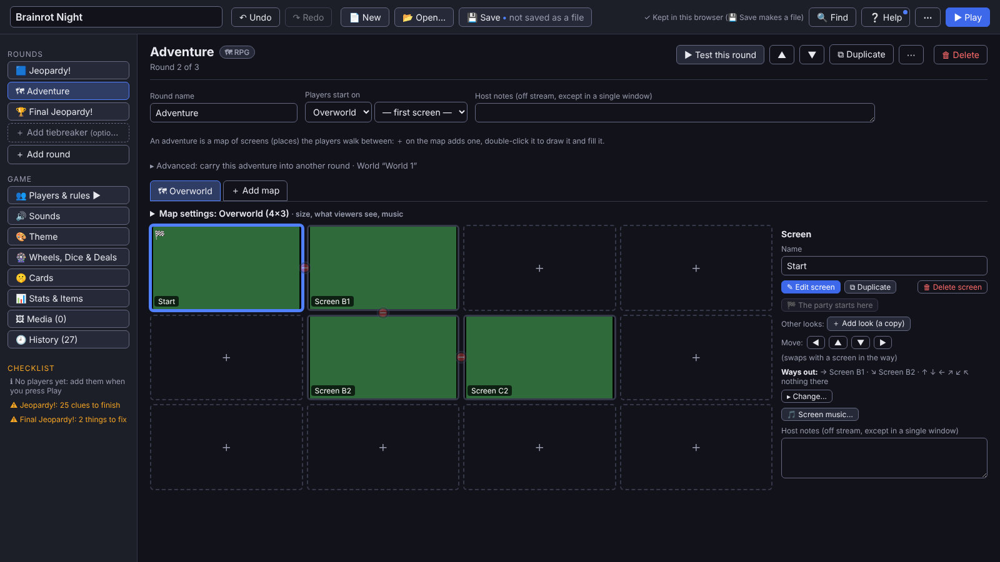
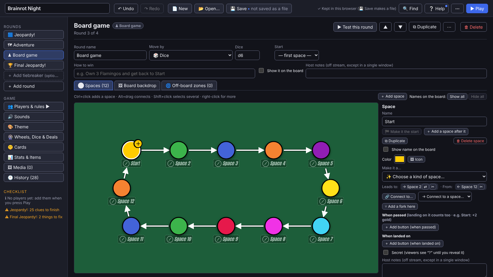
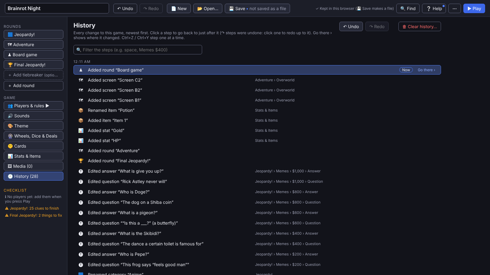

# Making games

[← Back to the README](../README.md)

A game is a list of rounds, and each round has a mode. You can reorder, duplicate or delete any round. **Copy round**
(a round's menu: right-click its tab, or ⋯ at the end of its page's top bar; or `Ctrl+C` on its tab) and **📋 Paste
round** (`Ctrl+V` on a tab pastes after it), or **📂 Import rounds…** (from a .brainrot file, or the web page a
game was exported as), bring a round from another game with the worlds, wheels, dice, stats, items, shops and files it
uses. Where this game already has one of those from another copy of the same game but it differs, the other version
comes in as a copy and this game's stays. A stat of a name and type this game has (HP, Gold) is this game's own, and so
is an item or shop of the same name that's the same otherwise; one of that name that differs comes in named apart
("Potion (copy)").

| Mode | What it is |
|---|---|
| 🟦 **Jeopardy board** | 1–10 categories × 1–10 clues. Supports custom values, Daily Doubles, 🤝 partner clues (placed by hand or 🔀 at random; two players, no buzzers, a steal on a miss if you like, private 🤫 cards you send to their phones or copy to them), 🤫 cards on any tile, and images on categories and tiles. |
| 🏆 **Final Jeopardy** | Private wagers, think music (with phone buzzers, players type their answer on their phone), then a one-by-one reveal and a winner screen; 🤫 cards of its own for the players you choose (＋ 🤫 Card in its editor). |
| 🗺 **RPG** | Players explore a map of screens. It has stats, items, shops, characters and doorways. |
| ♟ **Board game** | A path of spaces with forks and zones. Players move by dice, a wheel, or one space per turn. |
| 🖼 **Slides** | A few slides in a row (a welcome, the rules, a break); N goes from one to the next. |

Every clue or screen is a **slide**: text, images, GIFs, video, audio or YouTube, arranged freely.

<table>
<tr>
<td></td>
<td></td>
</tr>
<tr>
<td align="center">RPG world editor</td>
<td align="center">Board game editor</td>
</tr>
</table>

**Keyboard and drag:** round tabs, clue tiles, categories, rows, list items and map screens can be dragged and have
right-click menus; `Delete`, `F2`, `Ctrl+D` and `Ctrl+C` / `Ctrl+V` work on what's selected. `Alt`+arrows move them
too: on a board, `Alt`+`←` / `→` on a tile or a category's name moves the category and `Alt`+`↑` / `↓` on a tile its row.
A tile's menu has **Make it a…** (Standard, ⭐ Daily Double, 🤝 Partner clue, 🎡 Wheel tile…, 🎲 Dice tile…, then ✍
Everyone answers and ⬚ Empty tile), the kind it is ticked; a wheel or dice tile opens the clue at its Which wheel or
Which dice box. A tile with an answer made a 🤝 partner clue by hand (its Type, Make it a…, or a paste) starts with 🤫
Card 1 a copy of the answer, as 🔀 Randomize's do (the round's 🤫 Card choice “empty, to fill in” keeps it empty); an
empty card's words box has **⧉ Same as the answer** in its corner, and so does the checklist's line about it. A partner
clue's rules show its game, who describes and what it comes to in money on one line; the picker on the wheel, a typed
guess, a steal after a miss, the points and the part words are under **▸ More rules** (this computer remembers it open
or folded). Until a game has a tiebreaker clue, the list of rounds ends with **＋ Add tiebreaker (optional)**: one click
adds it (Ctrl+Z takes it back), and its page's ☑ Include a tiebreaker clue takes it out again. Files drop onto the slot
they belong in (a picture dropped on a tile asks: in the question, or as the tile's face). Press `?` (or **❔ Help** ›
⌨ Keyboard shortcuts) for every editor shortcut, and beside them, one click away, the host's during the game, with a filter for both. The longer help on the board, a slide, the RPG map and the board game page sits in a
**💡 Tips** fold that stays as you left it.

**Slide editor:** the selected item's buttons are in a bar pinned at the top of the side panel, its name, ⋯ (its
menu), its edit (✎ Edit text, ✎ Edit image…, ✎ Edit video… / sound…, Test link ↗…), ⧉ Duplicate, 🔒 Lock and, apart,
🗑 Delete (several selected: the same buttons, for them all), and a ⋯ just outside the selection's top-right corner on
the slide (beside a corner item's left edge, never over it) opens the same menu. Right after the slide tabs (a clue's, a Final's, the tiebreaker's, a slides round's)
is the open slide's group: ＋ Add slide, ⧉ Duplicate slide, 📋 Copy slide, 📋 Paste slide (as a new slide after this
one; its ▾ pastes over this one), ◀ ▶ and, apart, 🗑 Delete slide, the card's own on a 🤫 card's tab; a right-click on a
tab (or Shift+F10 on it) gives its menu, and Ctrl+C / Ctrl+V on a tab copy the slide and paste it as a new one.
Shape ▾ is in sections (Shapes, then Draw: ✏ Freehand line…, 🖌 Drawpad…; ⬚ Hotspot on an RPG screen only), and
**Background ▾** shows the picture as a thumbnail, with Change… and ⌫ Clear picture (the color stays) beside the Color
and ↺ Theme color, and ↺ Reset background apart. A double-click on an item (or Enter, with it selected) opens its editor: a text box's text, a
picture's ✎ Edit image, a video's or sound's ✎ Edit video / sound (or ✎ Edit the part it plays, its Plays from), a link's Link box, a shape's
Fill. F2 renames an item in the Layers list (on a text box it edits the text), and after you add a picture, video,
sound or link the keys stay on the slide. ✎ Edit image, 🖌 Drawpad and ✎ Edit video / sound work alike: ↶ Undo, ↷
Redo, Reset apart, then Cancel, Apply (Insert drawing) and ✕ along the top (a video's Cancel is at its foot, by its
ways to apply), `Ctrl+Enter` applies, Esc asks before throwing changes away (Discard, or Keep editing / Keep drawing),
and ✂ Crop pressed reads ✓ Done cropping, its shapes and Remove crop beside it. In ✎ Edit image, `M` / `C` / `D` / `T` /
`S` pick ✋ Select (captions and stickers), ✂ Crop, 🖌 Draw, 🅣 Text and 😂 Sticker, a right-click on a caption or
sticker duplicates or deletes it, and its side panel says This caption / This sticker or Whole picture (Straighten,
Picture size). A right-click gives the item's menu, headed by its name, in the editors' one order (✎ Edit, 🔁 Use
another picture… (video…, sound…), ✎ Rename, ⧉ Duplicate, ✂ Cut, 📋 Copy, 📋 Paste, the restacks, Align ▸, 🔒 Lock, 👁 Hide while editing,
🗑 Delete; a Layers row has it too); on an empty spot, or beside a full-slide question's words, the slide's own (＋ Text
here, 📋 Paste here, 📋 Copy slide, 📋 Paste over this slide, 🎨 Background… where you clicked, Select all), with the
question's ✎ Edit text and Align ▸ first while it's alone on the slide. Drag a box on an empty spot to select several items. Beside a text box's words counts as empty (until
it's selected), so a full-slide question doesn't move when you meant to select; `Alt`+drag always draws a box. Items
snap to the slide and to each other while moving and resizing (`Alt` turns it off). With several selected, Left /
Center / Right / Top / Middle / Bottom line them up with each other, and **Space evenly** spreads three or more. The
**Layers** list shows whenever the slide has an item, so every item can be reached from the keyboard. Text outlines,
shadows and glows get room inside their box, so they're never cut off at its edge, and **Typewriter (letter by
letter)** types the text out (all at once with reduced motion). The same file added twice is stored once (a toast says
it's already in 🖼 Media). Replacing a file in 🖼 Media redoes the ✎ edits of pictures made from it on the new file.
**✎ Edit…** in 🖼 Media (or ✎ Edit video… on a slide's item, in its panel or its right-click menu) trims a video or
sound, and crops and resizes a video, for every place that uses it; slides' Plays from / to move with the trim. Save
as a new file keeps the original too, and from a slide item, Only this item edits it for that item alone. Ctrl+Z puts
the old file back. A picture's, video's or sound's panel has **🔁 Use another picture… / video… / sound…** (only this
item; 🖼 Media's Replace everywhere… is for every place), and a video's or sound's (or an online one's) says the part it
plays as **Plays from [0:00.0] to [the end]**: type 83, 1:23 or 1:23.5 (empty is the start or the end; ↑ / ↓ step
0.1 s), and **▶ Try it** plays that part (pressed again, it stops). That's only this item; ✎ Edit video… cuts the file
itself. Autoplay, Loop, Start muted and Volume are under **When it plays**. The toolbar's sound button is 🔊 Sound.

**RPG map editor:** drag a screen to move it or swap it with another (dropping past the edge grows the map, dropping
on a map tab moves it there), `Delete` deletes the selected screens, arrows / `Enter` / `Alt`+arrows / `Ctrl+D` /
`Ctrl+C` `Ctrl+V` / `F2` work on the grid, `Shift`-click or a box selects several (`Alt`+drag draws a box from
anywhere, on a full map too), and pictures dropped on the map become screens. Click ⛔ between two screens to block
the way. A screen's **Ways out** is one line, “Ways out: → Forest · ← ↑ ↓ nothing there”, and **▸ Change…** opens a box
for each side (the diagonals only when the map allows them, or one has a rule); it opens by itself on a screen with a
side blocked or leading somewhere else, and after ⛔. The round's world (to carry the adventure into another round) is
under **▸ Advanced**, and an item's description, notes, Use buttons and worn look under its **▸ More**; this computer
remembers which folds you left open.

**Board game editor:** the board keys the same way. It's one `Tab` stop: the arrows go to the nearest space that way
(`Shift` adds it to the selection), `Enter` opens its settings and `Tab` goes on to them. `Alt`+arrows move the selected
spaces (`Shift`+`Alt` further), `F2` renames, `Ctrl+D` duplicates, `Ctrl+C` / `Ctrl+V` copy and paste spaces with their
buttons (onto any board, in any game), `Delete` deletes. `Ctrl`+click adds a space, `Alt`+drag links two, and
**＋ Add space** on the board's tools row adds one after the selected space. A space's own buttons are right under its
name: 🏁 Make it the start, ＋ Add a space after it, ⧉ Duplicate and, apart at the end, 🗑 Delete space (several
selected: ⧉ Duplicate, 📋 Copy, Clear selection, 🗑 Delete 3 spaces). The
movement dice are kept by the dice themselves, so renaming them in 🎡 Wheels, Dice & Deals keeps them.

Other editor tabs:

- 👥 **Players & rules ▶** (first in the Game list, with how many players): the players, ⚖ Game rules and phone
  buzzers are set on the ▶ Play screen before the show, and this opens it at 👥 Players (nothing starts until **Start
  game ▶**).
- 🔊 **Sounds**: the sounds played on stream (right, wrong, dice, wheel, buzz…): preview, replace or switch each off.
- 🎨 **Theme**: presets, colors, fonts (your own font file too: Fonts › Your own font file) and background images.
  **💾 Save as new theme…** keeps a look in My themes (in this browser, or on this computer in the desktop app) for any
  game. Under **▸ Share or bring in a theme** (folded until you open it; a theme file dropped on the editor opens it),
  **⬇ Export theme** (a `.brainrot-theme` file) or **📋 Copy theme code** shares it, and **📂 Import theme…** /
  **⌨ Paste theme code…** show someone else's on your board before you use or keep it. A click on the preview finds
  the setting of what you clicked (a tile, a value, a category, a score plate, the score bar or the board): it opens
  and flashes. Tile glow's size is beside its tick, in Colors.
- 🎡 **Wheels, Dice & Deals**: weighted wheels, custom dice and 🎭 deals (a secret part for everyone). Each wheel or
  dice outcome can carry a score effect or action buttons. A new one (＋ Add, or 📋 Ready-made) opens with its name
  selected, to type over; `Enter` on one in the list (or on a 🤫 card) goes into it, at its name.
- 🤫 **Cards**: private cards made before the show (words, pictures, GIFs, videos, sounds or a link on each), each with
  a name you pick it by. During the show **🤫 Send a card…** sends one to the players you choose: only they see it, on
  their phones. In one window viewers can read a card's name in that dialog (never what's on it), so keep the secret
  on the card.
- 📊 **Stats & Items**: HP bars, currencies, items, wearable gear and shops. Until an RPG or board game round uses it
  (or it has anything in it), it's listed muted, "(optional)".

**Copy and paste** slide items or whole slides between clues, rounds and even games; their pictures and sounds come
along.

**Right-click** almost anything for a quick menu. This works on rounds, tiles, categories, list rows, map screens,
spaces, avatars and items (`Shift+F10` or the menu key opens it where the keys are, and a row's **⋯** opens it too).
Every menu goes in the same order: what a click on it does (✎ Edit), what it can do or be made (Make it a…),
✎ Rename · ⧉ Duplicate · 📋 Copy · 📋 Paste, ▲ ▼ / ◀ ▶ and ＋ Insert, its own extras, its row's or column's own group (a
tile's “Row 2 · $400”: move, insert above or below, delete), then ⌫ Clear and 🗑 Delete in red, last. Each item shows
its key, the Mac way on a Mac. A right-click in a category's name or a row value opens its menu, unless you're typing
in it: then it's the browser's Cut, Copy and Paste.

**Lists** (stats, items, shops, buttons, zones, wheel slices, a deal's parts, dice, choices) have one row: ⋮⋮ to drag
it (or `Alt`+`↑`/`↓` in it), its fields, **⋯** for its menu (⧉ Duplicate, ▲ Move up, ▼ Move down…; `Ctrl+D` duplicates)
and, apart at its end, a red 🗑 (Undo brings it back). A wheel slice's ↻ Spin again is in its ⋯ (a slice that spins again
says **↻ again** after its label; a click turns it off, and its ▸ More has the tick); `Enter` in a slice's label or a
deal part's name adds the next one, `Backspace` in an empty one deletes it. ▶ Play's players keep their ▲ ▼.

**Colors:** a click on a color box opens the app's color picker. Drag in the square and along the color bar, or type
the color as **Hex** (`#ff00e6`) or **RGB** (three numbers, 0–255): both are always there to switch between, and the
one you used last comes back (a click in the Hex box selects the color there, so one typed or pasted replaces it).
**💧 Pick from the screen** takes a color from anywhere on the screen (in the desktop app, with a magnifier to aim: click
the pixel, or press `Enter`; the arrow keys move one pixel, ten with `Shift`; `Esc`, a right-click or switching to
another window cancels). The color it was sits beside the new one, and a click on it puts it back. `Enter` or
**✓ Done** keeps the color, one undo step; `Esc` puts back the one it had.

**Undo** (`Ctrl+Z`, `Ctrl+Y` to redo) covers every change in the editor and takes you to where it happened. Deleting
doesn't ask first: a "Deleted … · Undo" note brings it back. The **🕘 History** tab lists every change and jumps back to
any point; it survives a reload (⚙ Settings sets how many changes it keeps, 300 by default). A right-click on a step
goes back to just after it (or redoes up to it), goes there, or copies its name, and a right-click on the header's
↶ Undo or ↷ Redo opens 🕘 History, as on the game screen. During the game, a right-click on a row of the 📜 Log's
🕘 History has ↶ Back to here, ↶ Reopen tile and, for a score, ↶ Undo just this score (or ↷ Restore), under the row's
own words.

